## КТ №10 Выполнение тестовых заданий

Задание 1. Веб-форма регистрации пользователей

Цель: разработать веб-форму с серверной валидацией для регистрации пользователей.

Задачи: 

Создайте веб-форму с полями:- Имя пользователя (не менее 3 символов, только буквы)- Электронная почта (должна содержать @ и .)- Пароль (не менее 8 символов, должен содержать цифры и буквы)- Подтверждение пароля (должно совпадать с полем пароля)При отправке формы данные должны проходить валидацию на сервере.При успешной валидации пользователь добавляется в базу данных (имитация через сохранение в файл или использование in-memory базы данных).Пользователю отображается сообщение об успешной регистрации или об ошибках валидации.

Задание 2. Разработка RESTful API для управления данными пользователя

Цель: создать RESTful API, которое позволит получать, добавлять, обновлять и удалять информацию о пользователях.

Задачи:

1. Создать API, какое должно поддерживать следующие операции:

GET для получения списка всех пользователейGET (с ID) для получения конкретного пользователяPOST для добавления нового пользователяPUT (с ID) для обновления данных пользователяDELETE (с ID) для удаления пользователя

2. Данные должны храниться в in-memory базе данных.

3. Для каждого запроса необходимо реализовать валидацию данных.

4. Предусмотреть обработку ошибок, включая несуществующие ID пользователей.

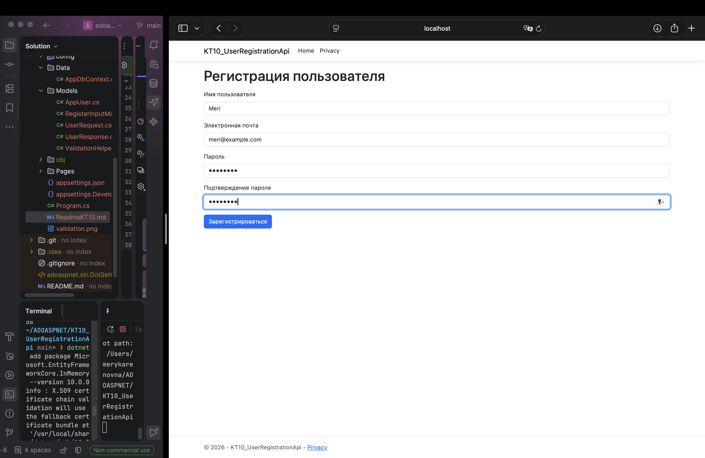

-------------------------
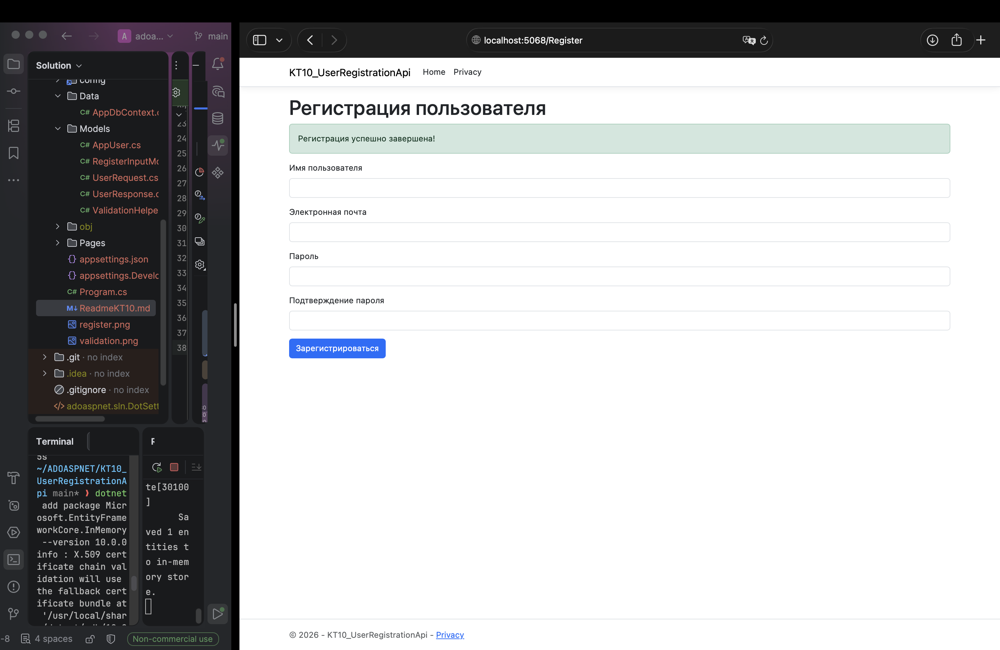

---------------------
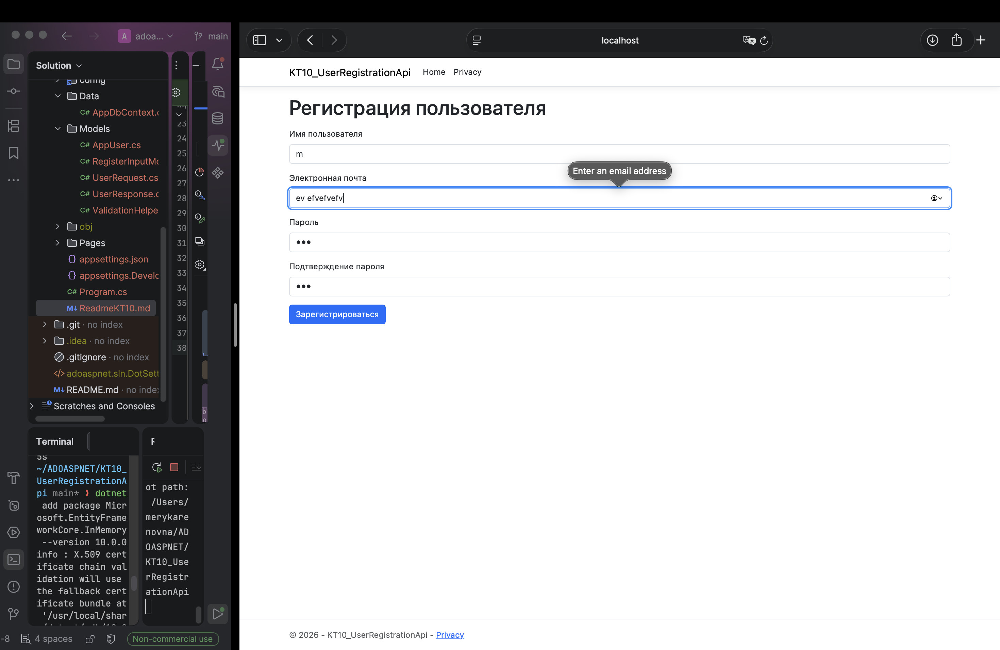

------------------------------
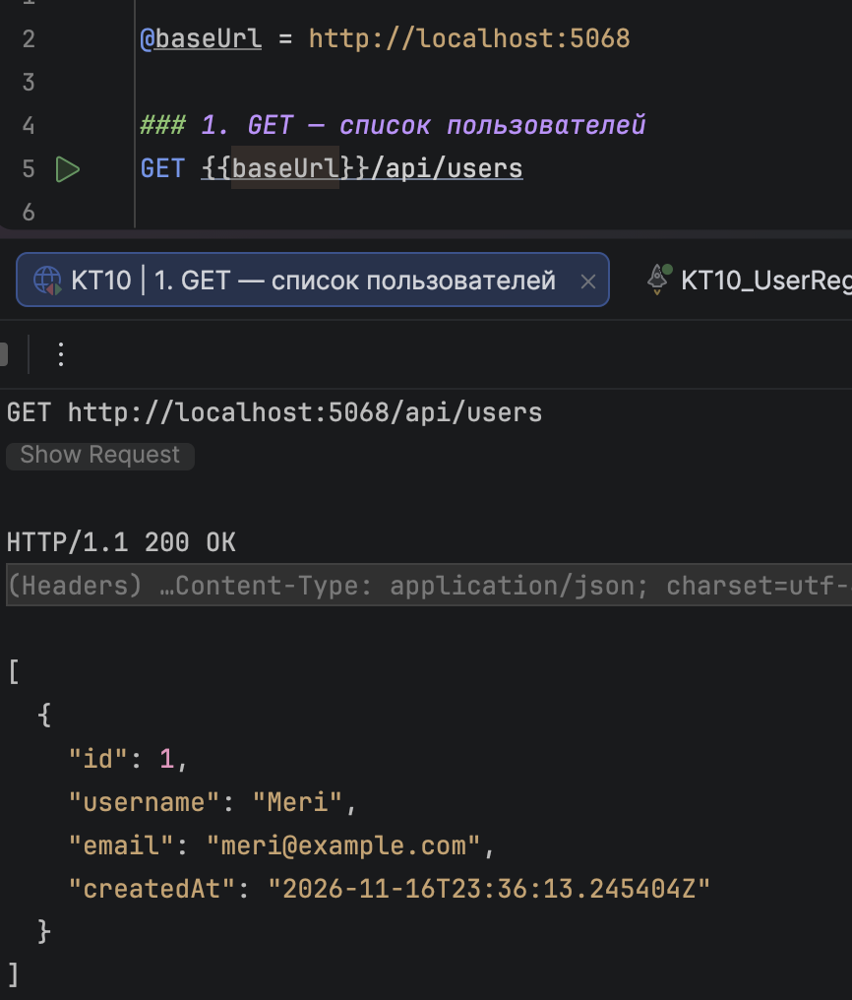

-------------------------
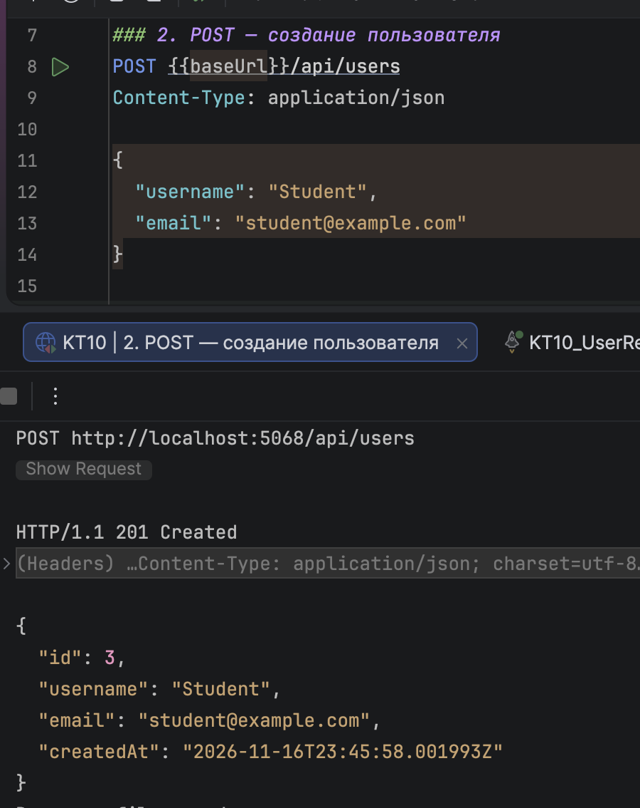

--------------------
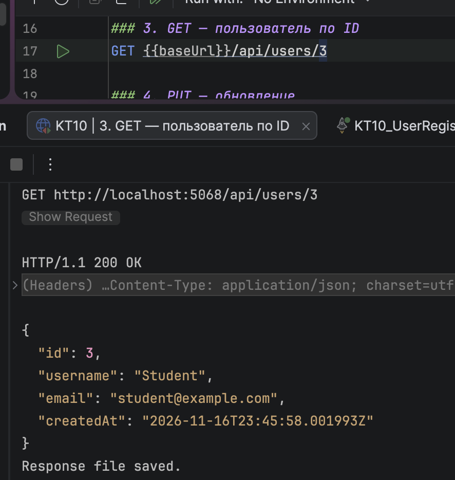

------------------
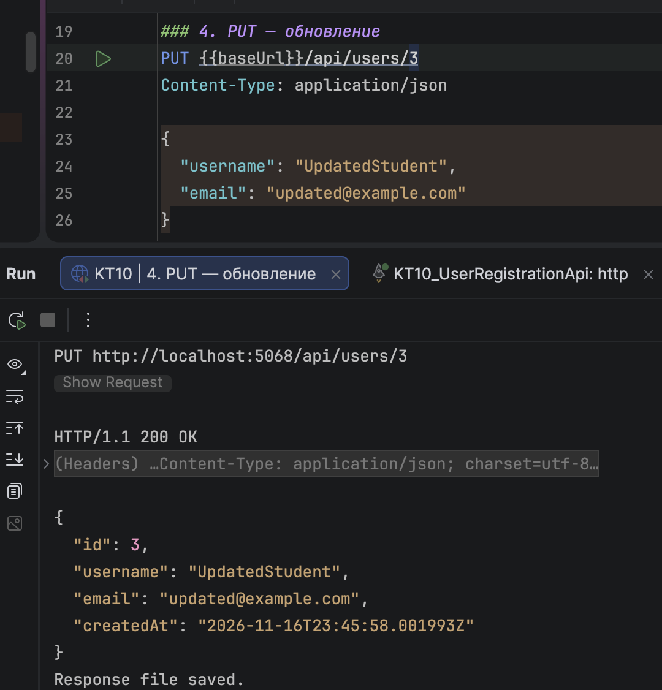

---------------------
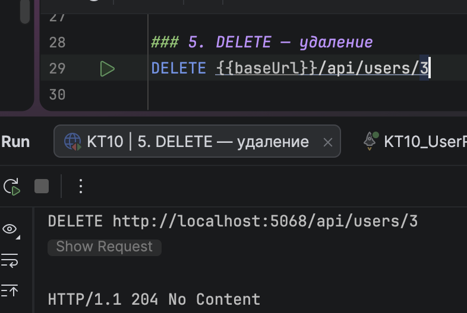

---------------
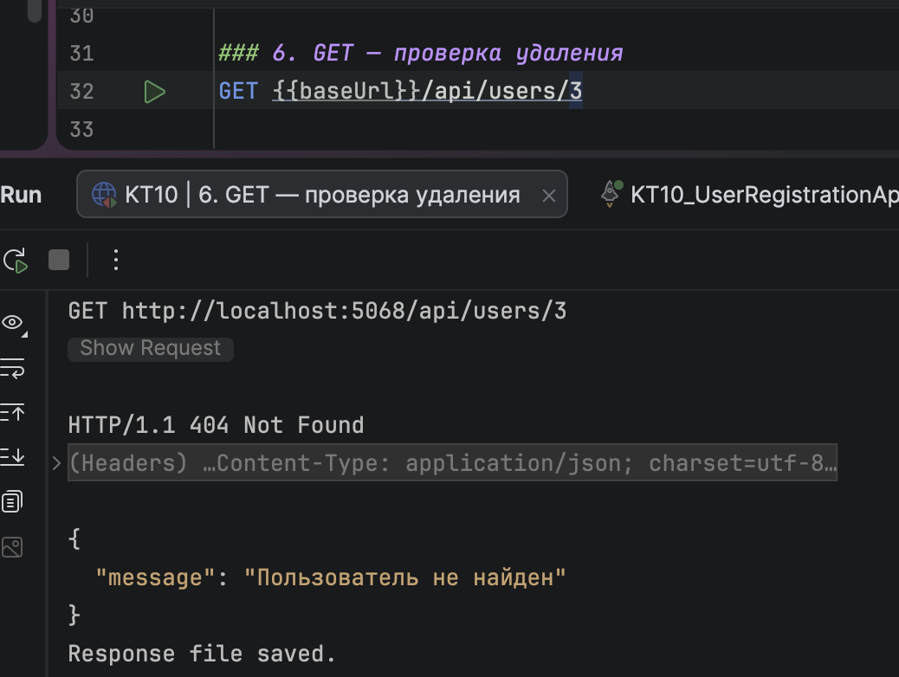

----------------
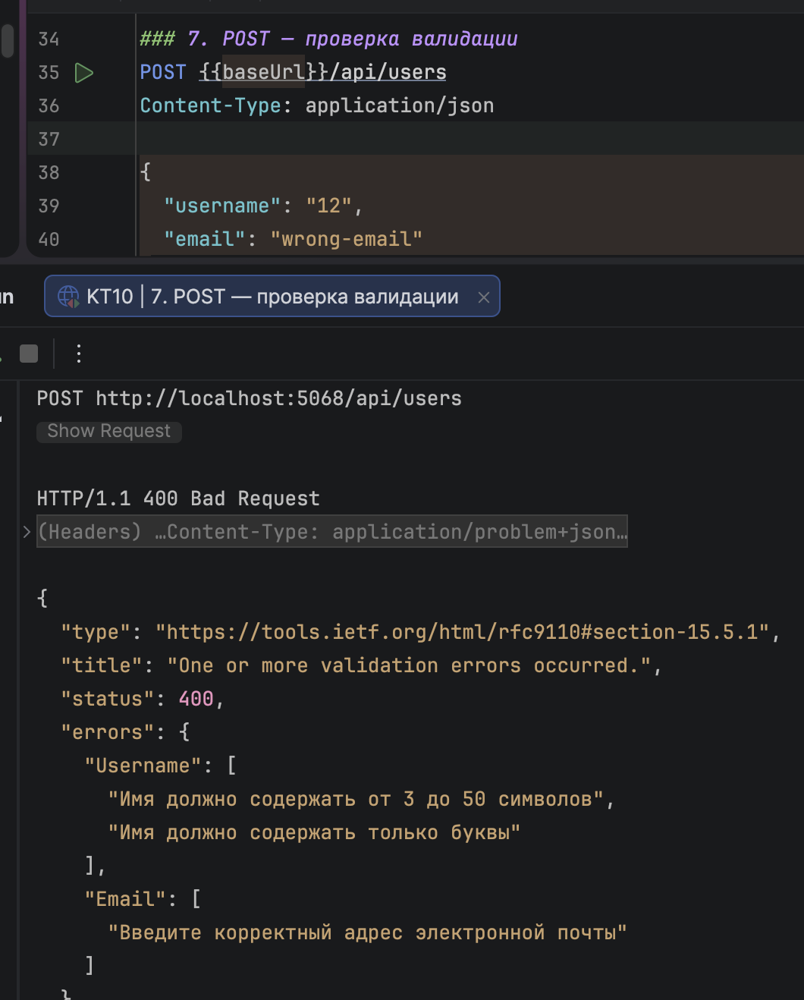

---------------------
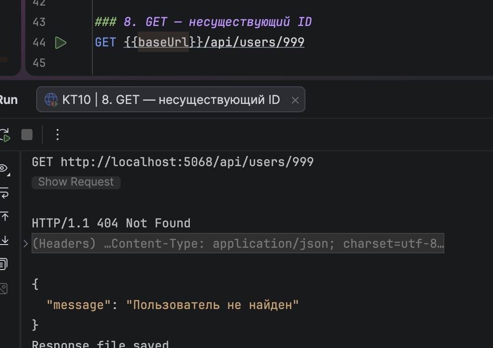
