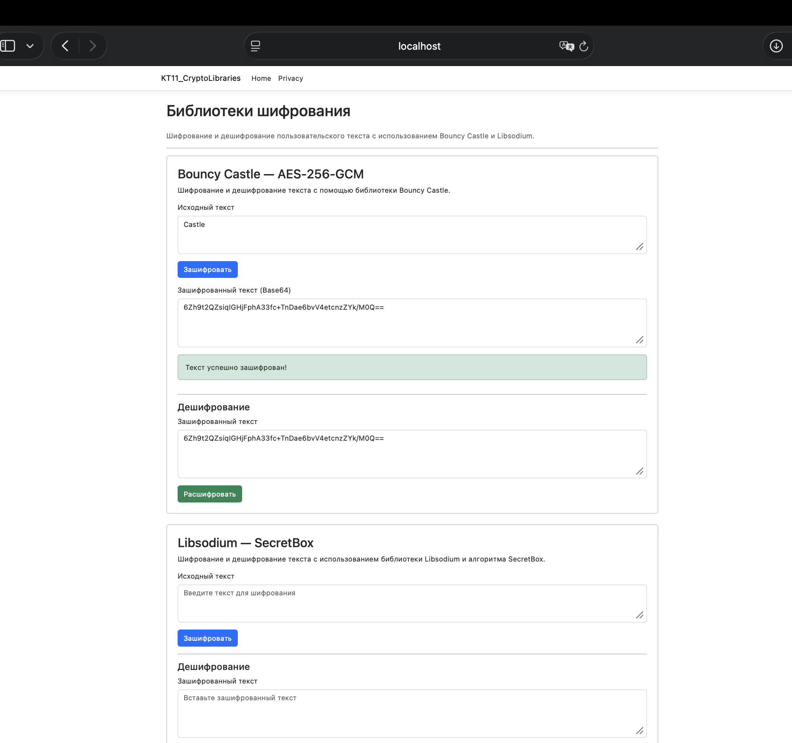
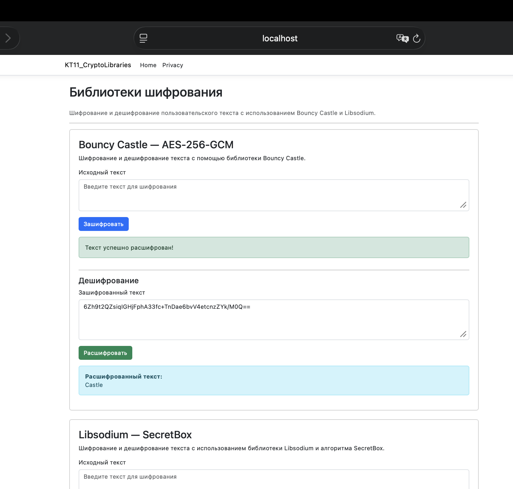
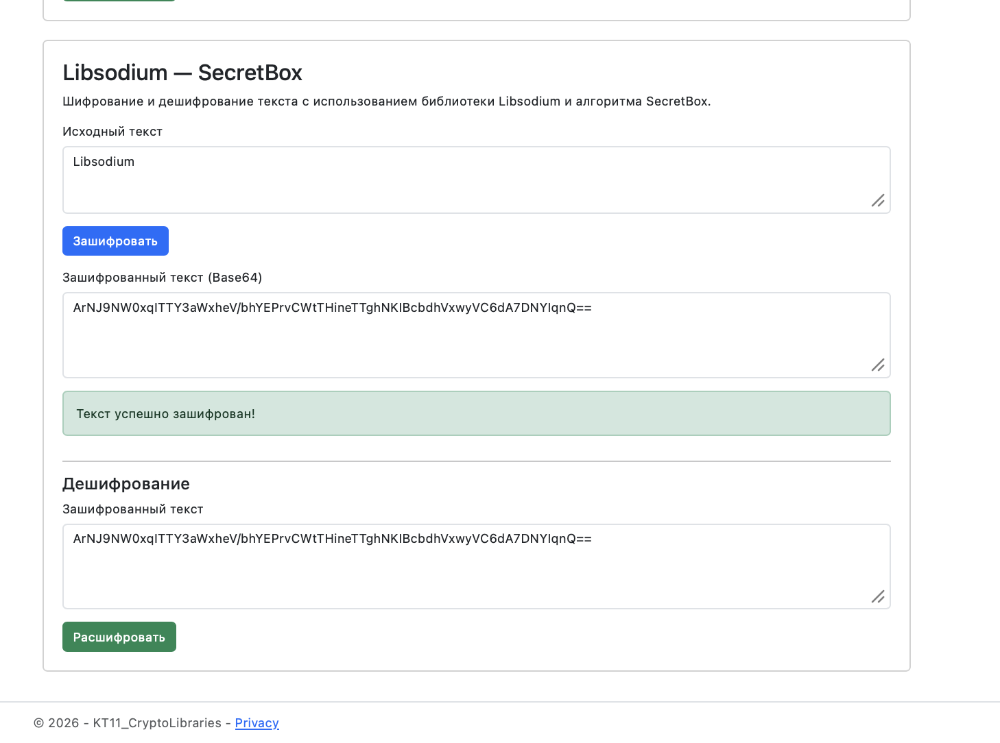

## Задание «КТ-11 Библиотеки шифрования»

### Задание 1. Bouncy Castle
Цели: изучить и применить библиотеку Bouncy Castle для шифрования и дешифрования текстовых данных.
Задачи:
Интегрировать Bouncy Castle в проект ASP.NET Core.
Реализовать AES шифрование и дешифрование.
Создать веб-интерфейс для ввода текста пользователем и отображения зашифрованных/расшифрованных данных.

------------------------------

### Задание 2. Libsodium
Цели: освоить использование библиотеки libsodium для безопасного шифрования данных.
Задачи:
Добавить libsodium-core в проект ASP.NET Core.
Реализовать функции шифрования и дешифрования с использованием libsodium.
Создать интерфейс для шифрования пользовательских данных и отображения результатов.

-----------------------

