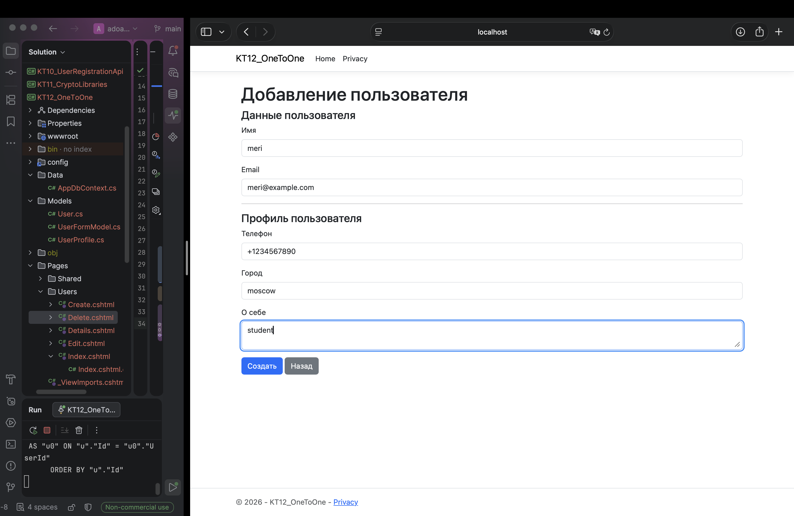
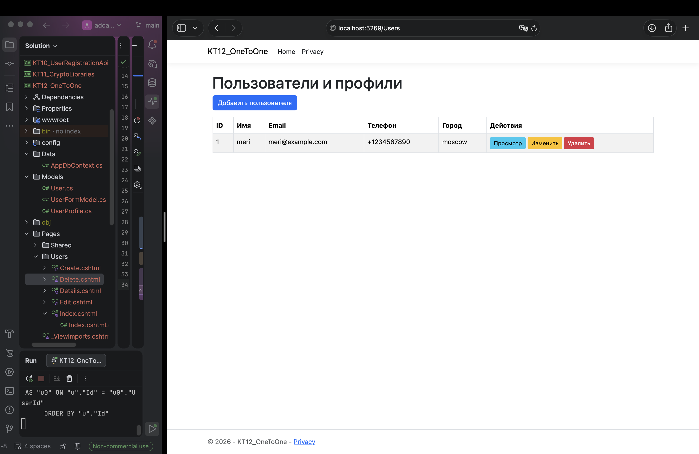
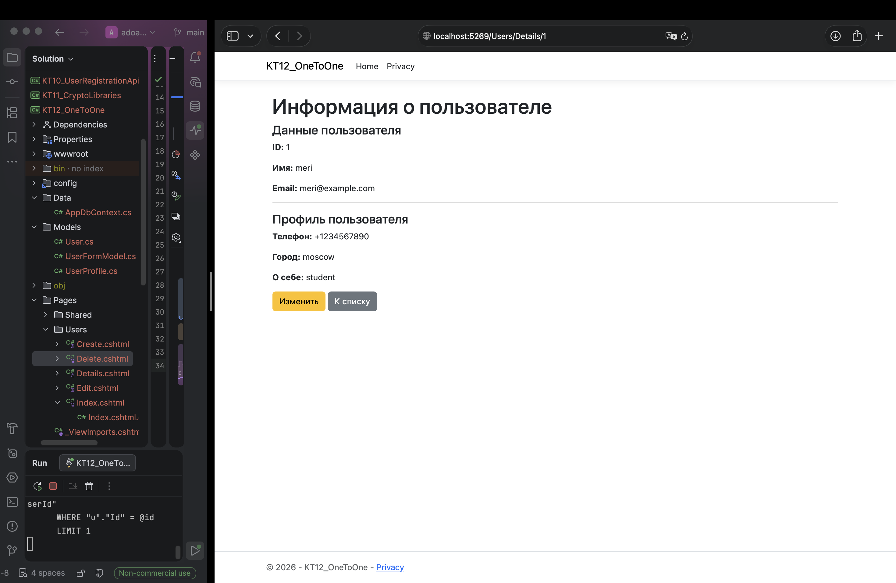
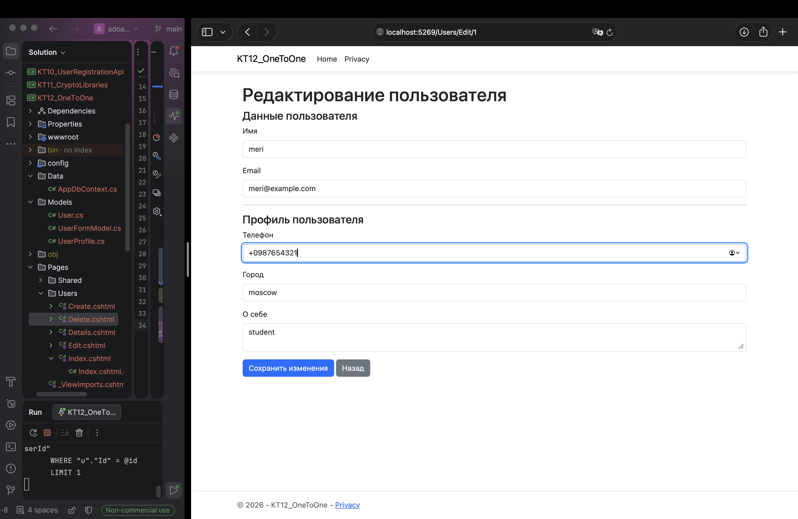
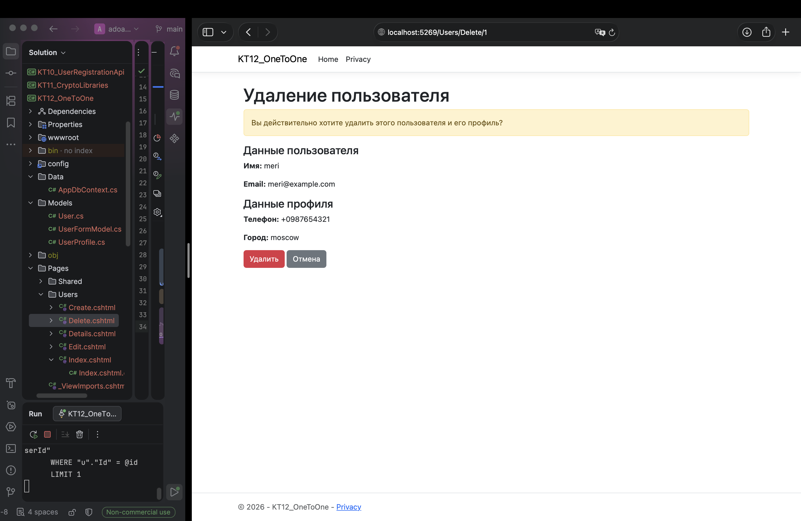
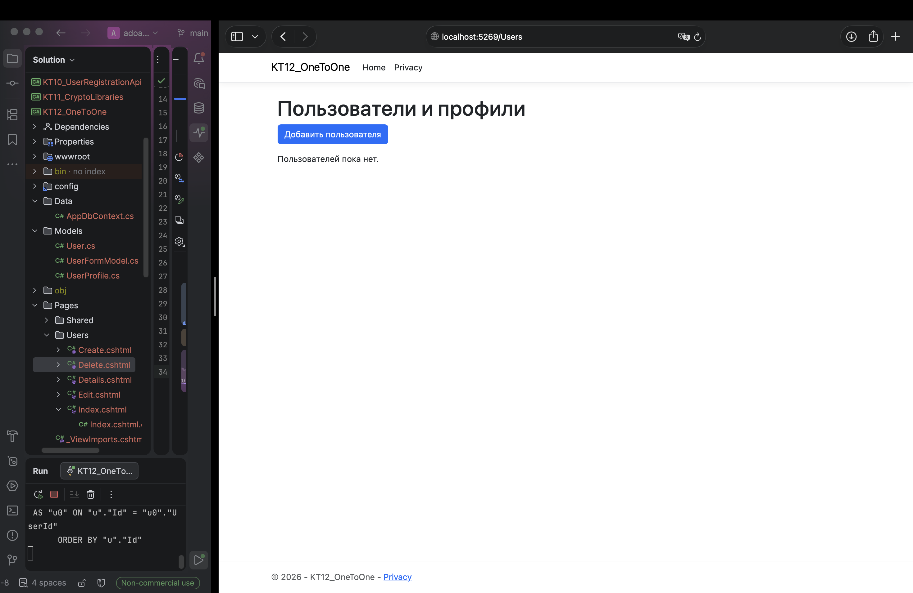
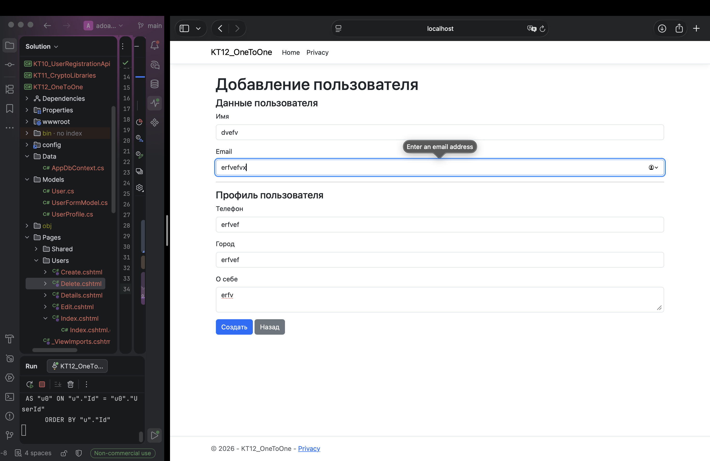

## КТ №12 Отношения один к одному
Создайте систему управления профилями пользователей. Каждый пользователь будет иметь один профиль, а каждый профиль будет связан с одним пользователем. Проект будет включать создание моделей данных, настройку отношений один к одному, реализацию CRUD операций и создание пользовательского интерфейса.
1. Создание моделей данных:
Создайте модели User и UserProfile.
Настройте отношения один к одному между User и UserProfile.
2. Настройка базы данных:
Используйте атрибуты и Fluent API для настройки моделей данных.
Настройте каскадное удаление для отношений один к одному.
3. Создайте CRUD операции для управления пользователями и их профилями.

