КТ №13 Отношения один к многим
Создайте систему управления библиотекой, включающую авторов и книги. Каждый автор может написать несколько книг, но каждая книга может иметь только одного автора. Проект должен включать создание моделей данных, настройку отношений один ко многим, реализацию CRUD операций и создание пользовательского интерфейса.

1. Создание моделей данных:

Создайте модели Author и Book.Настройте отношения один ко многим между Author и Book.

2. Используйте Fluent API для настройки моделей данных.

3. Настройте каскадное удаление для отношений один ко многим.

4. Создайте CRUD операции для управления авторами и книгами.

5. Реализация пользовательского интерфейса

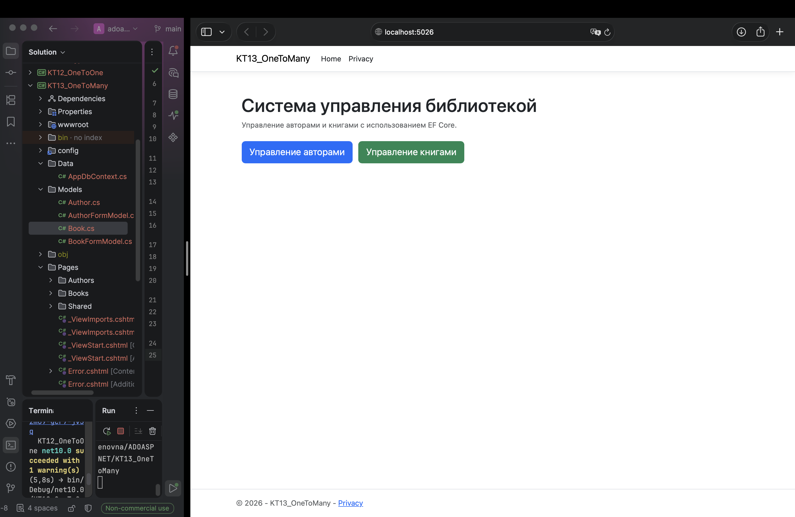
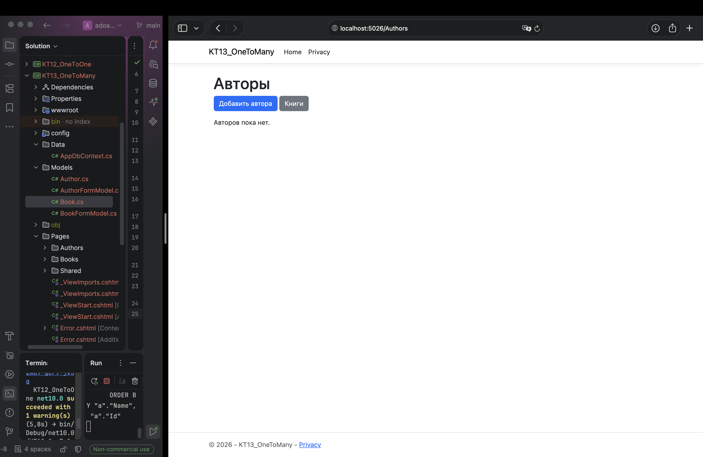
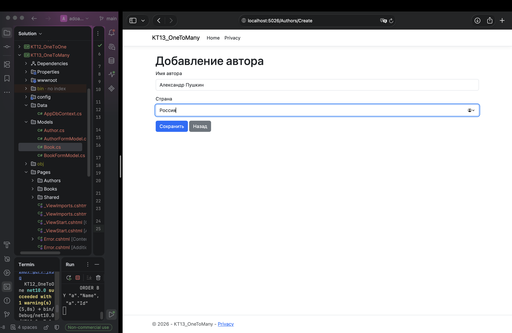
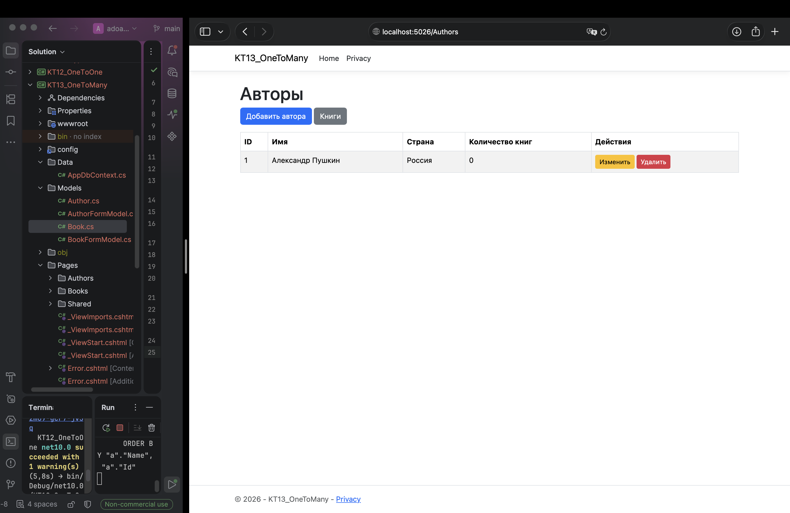

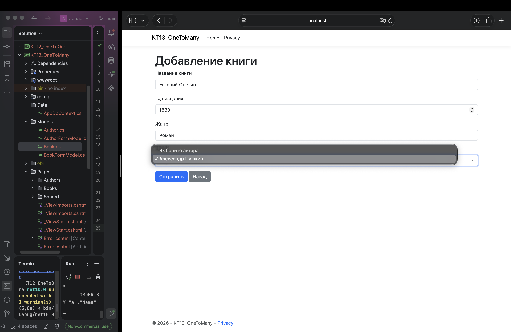
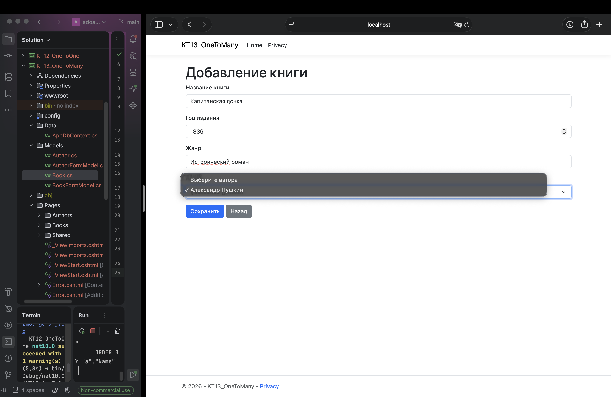
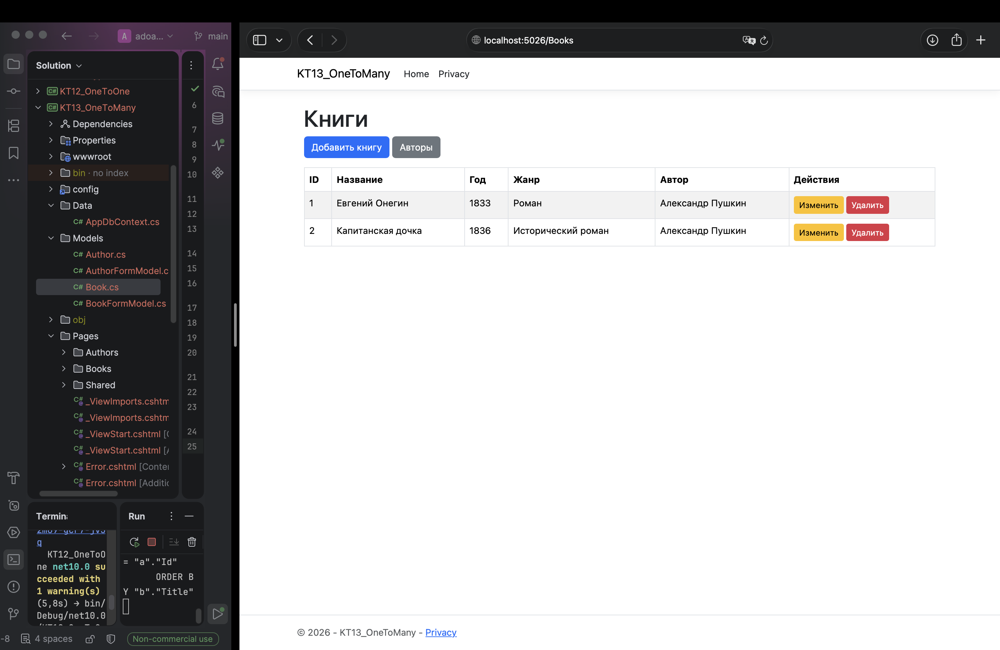
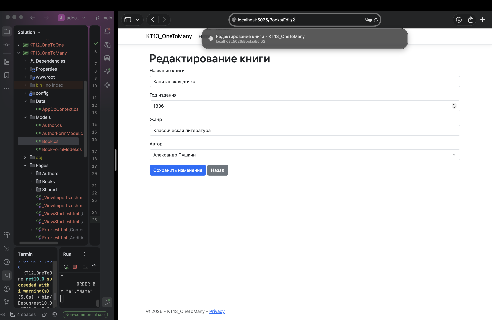
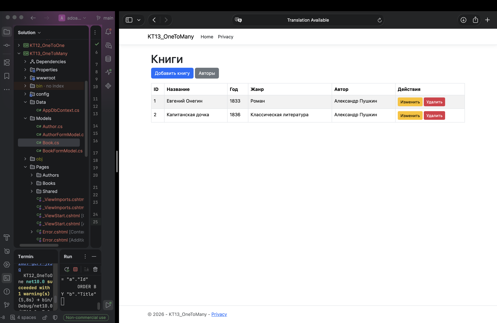

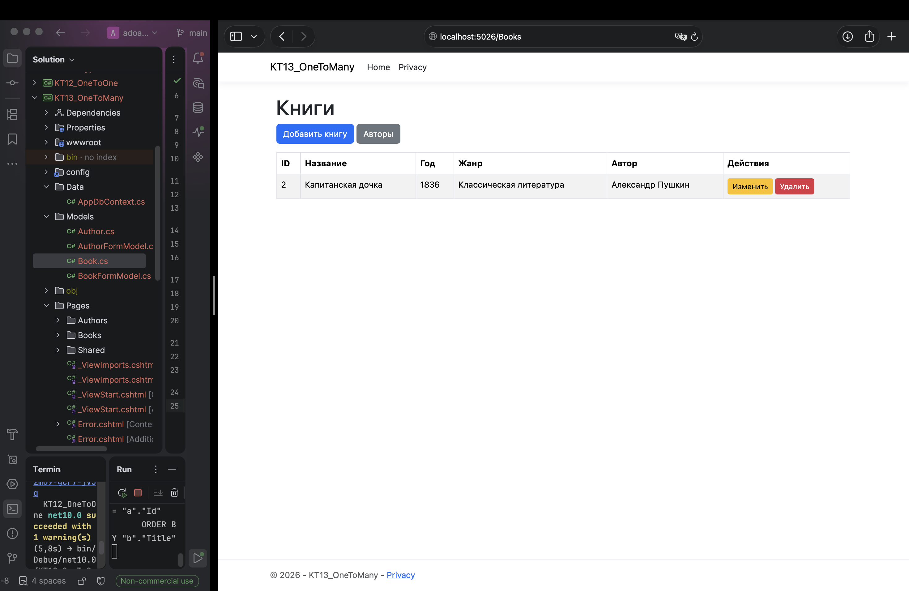
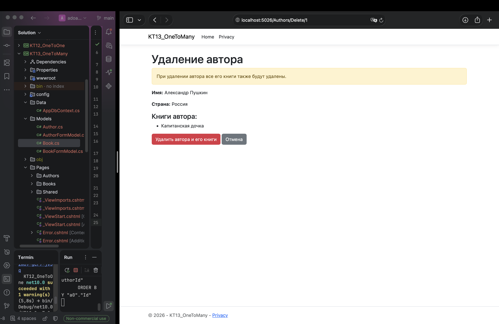

