## КТ №14 Отношения многие к многим

Создайте систему управления учебным процессом, включающую преподавателей, курсы и студентов. Каждый студент может записаться на несколько курсов, каждый курс может включать несколько студентов, а каждый преподаватель может преподавать несколько курсов.

1.  Создание моделей данных:

Создайте модели Teacher, Student и Course.Настройте отношения многие ко многим между Student и Course.Настройте отношения один ко многим между Teacher и Course.

2. Настройка базы данных:

Используйте атрибуты и Fluent API для настройки моделей данных.Настройте каскадное удаление для всех отношений.

3. Реализация CRUD операций:

Создайте CRUD операции для управления преподавателями, студентами и курсами.Обеспечьте возможность добавления студентов на курсы и назначения преподавателей для курсов.

4. Создайте простой пользовательский интерфейс для управления данными на базе ASP.NET Core.

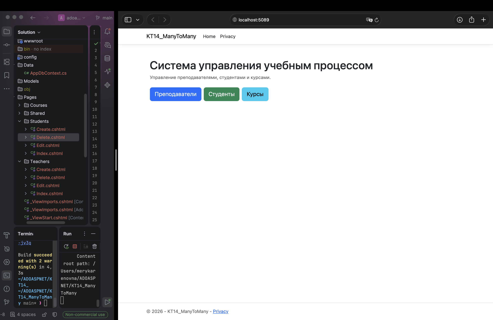
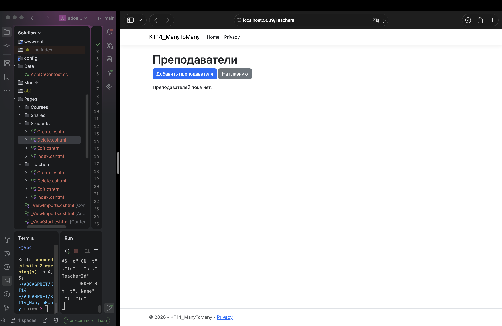

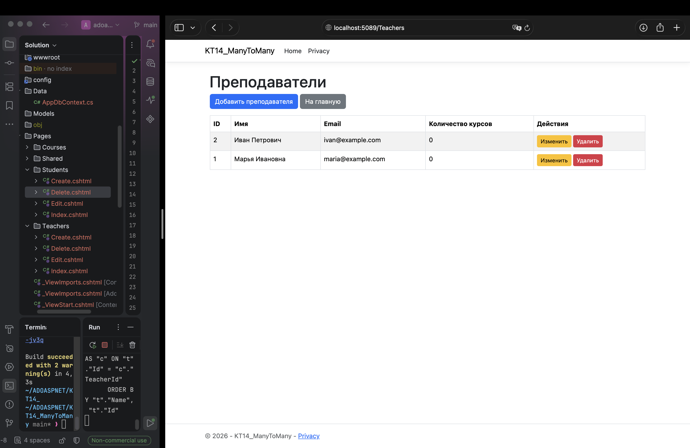
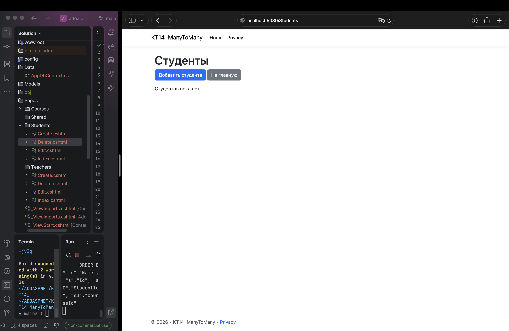
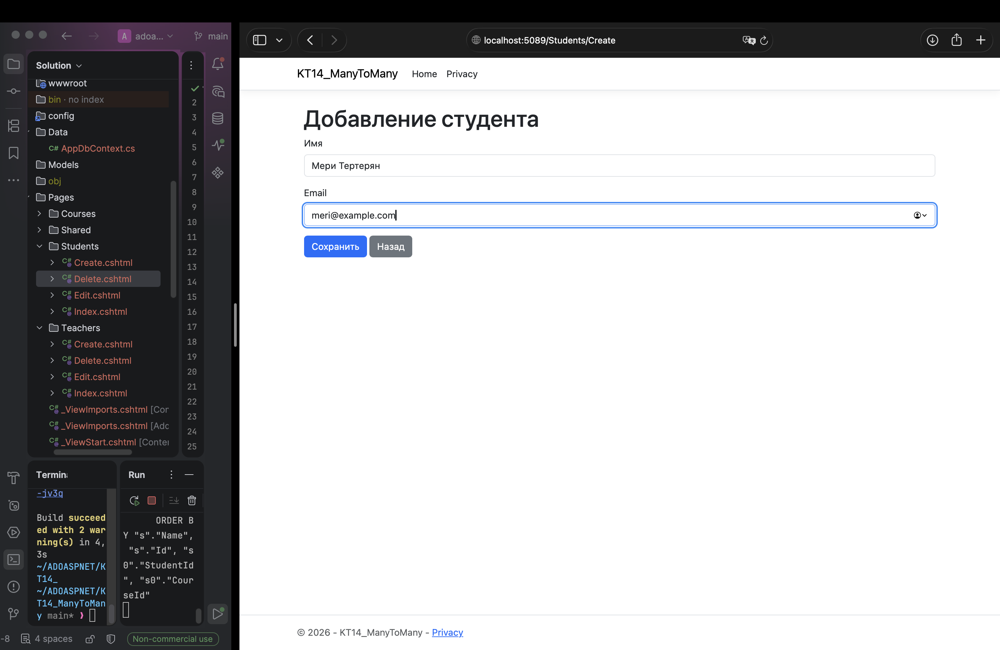
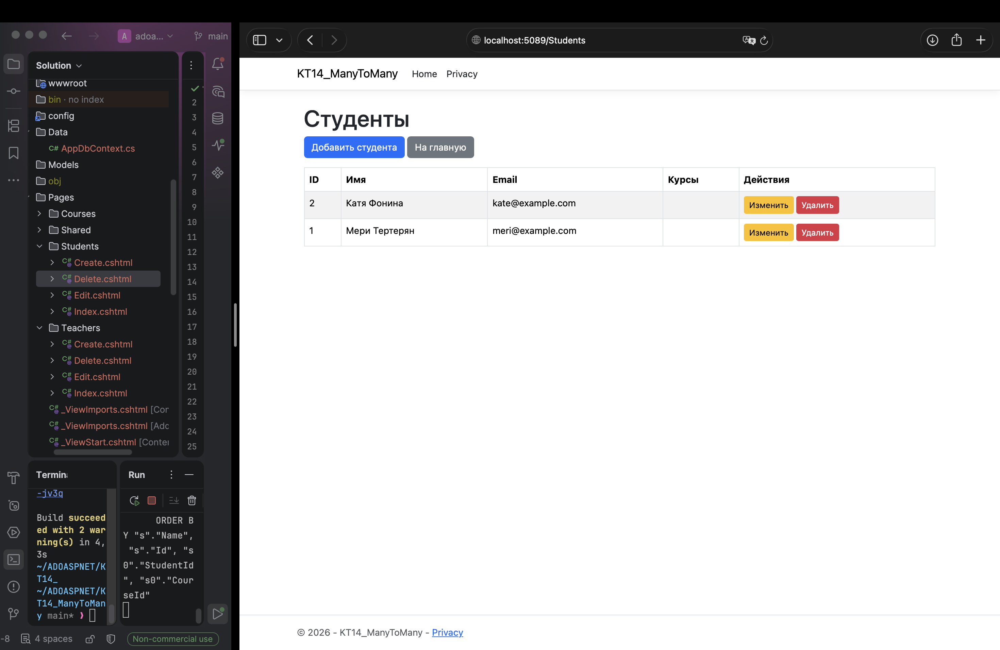
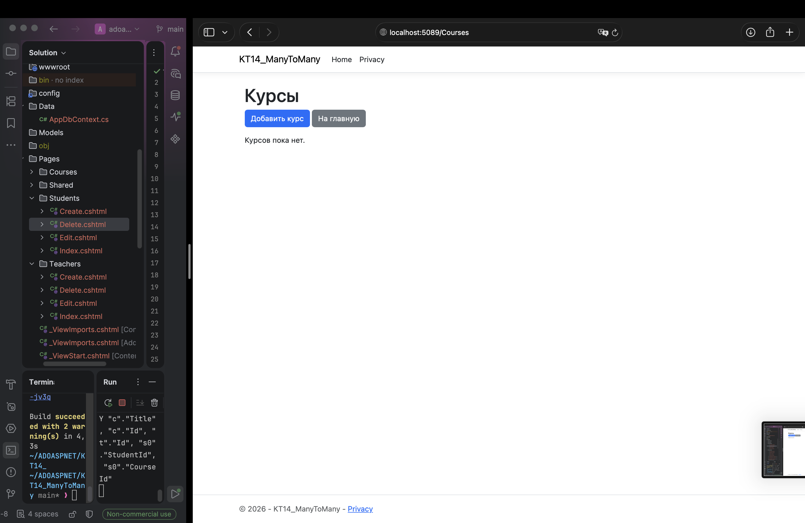
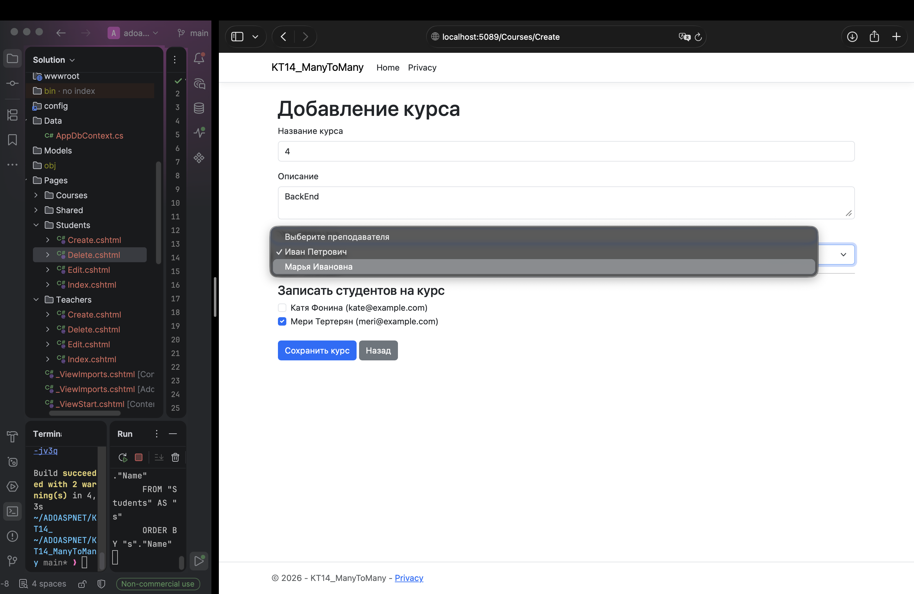
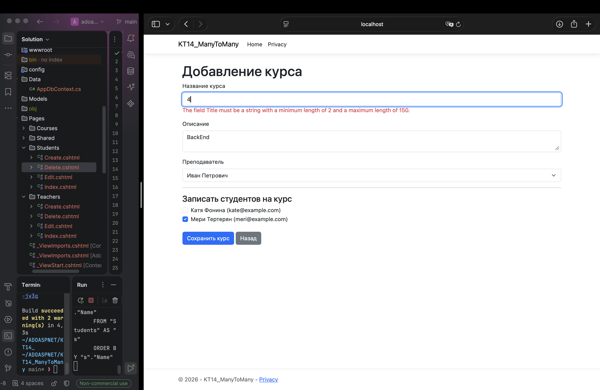
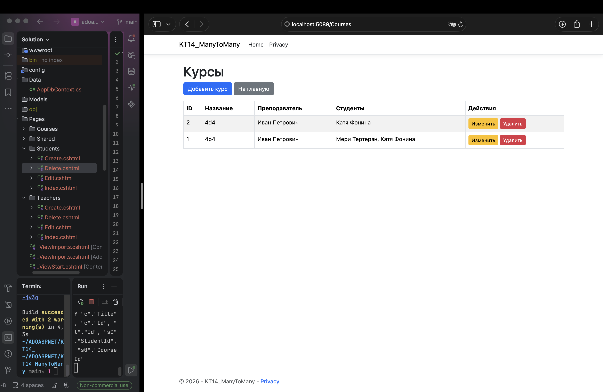
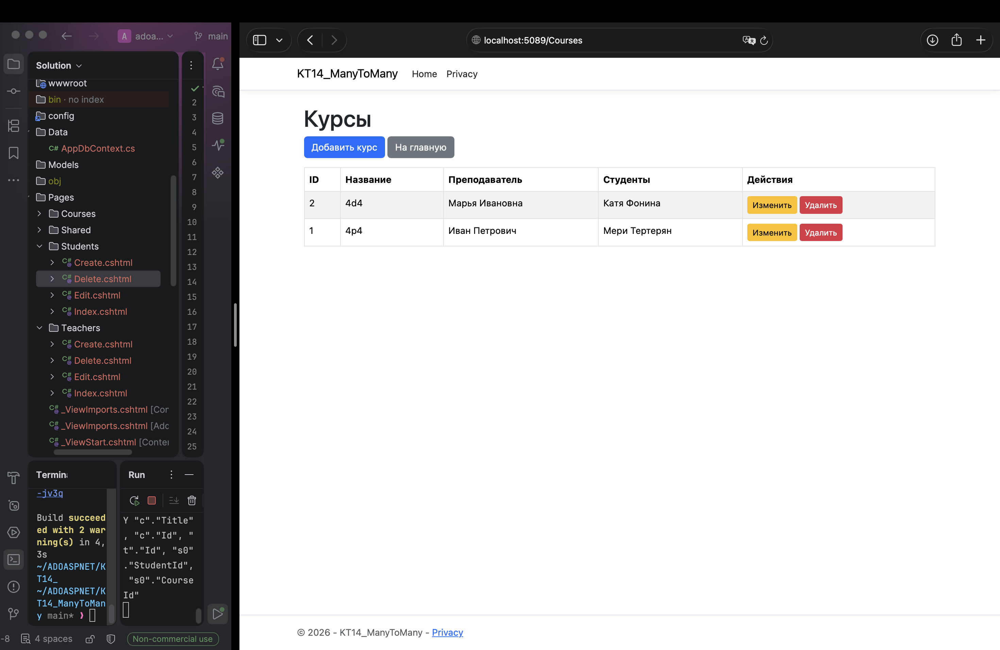
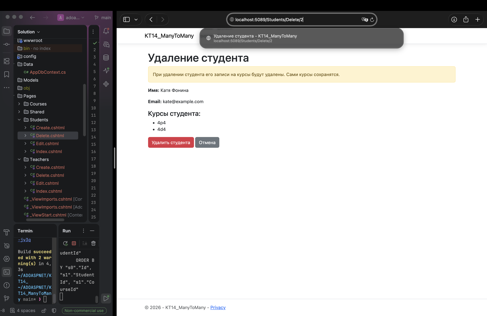

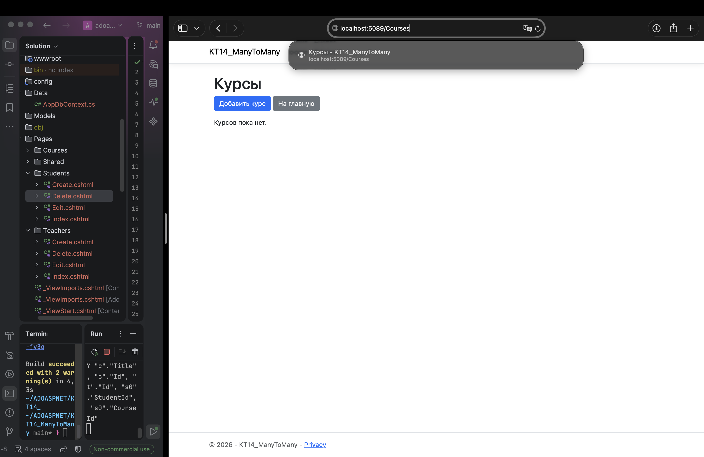
