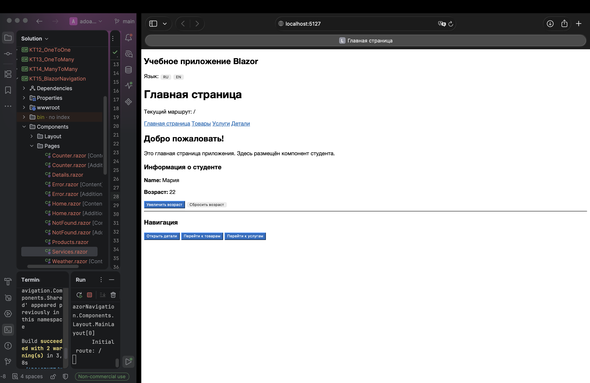
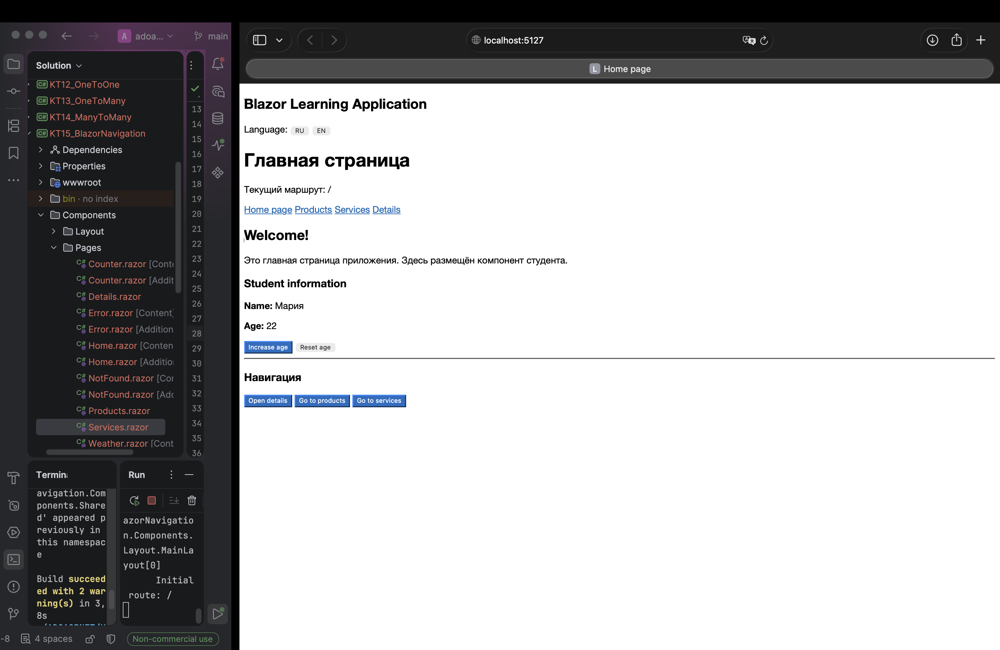
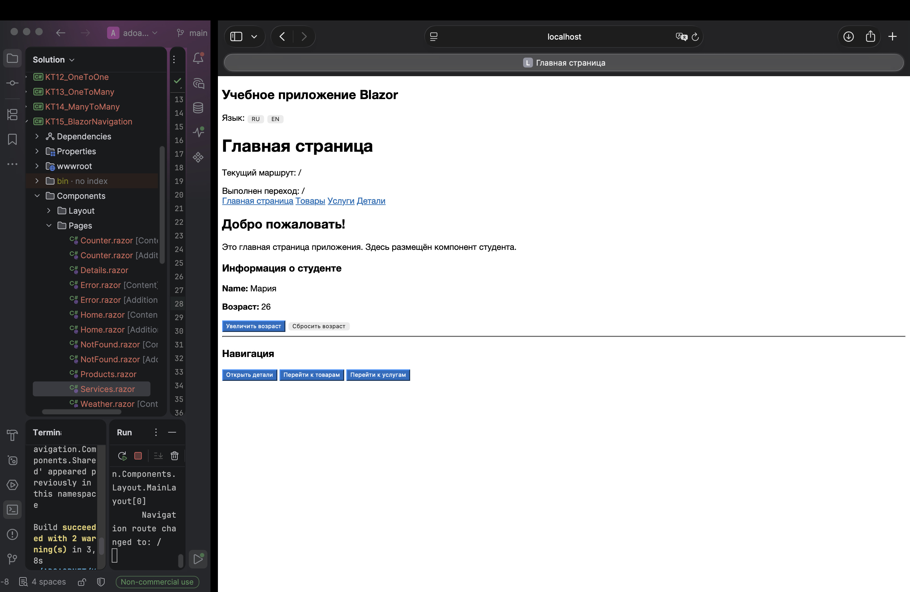
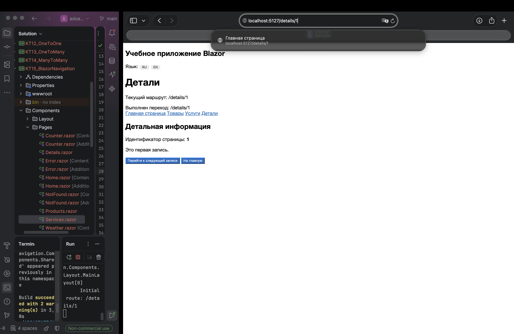
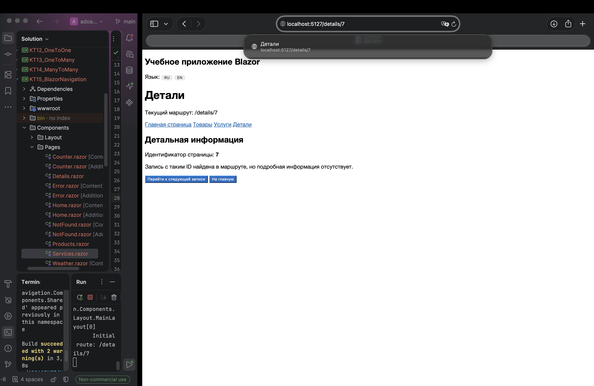
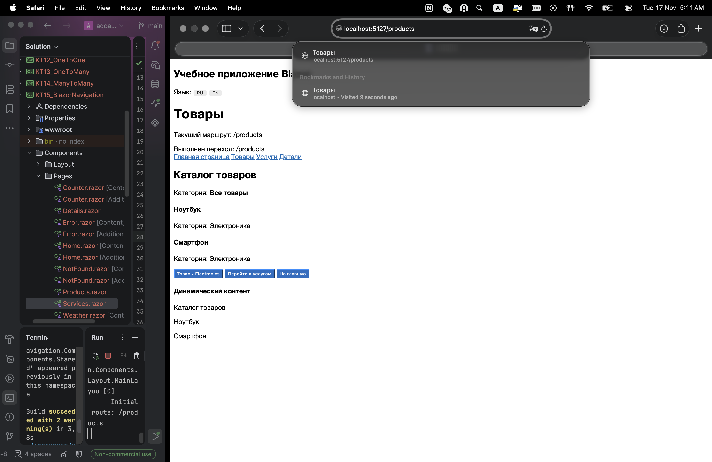
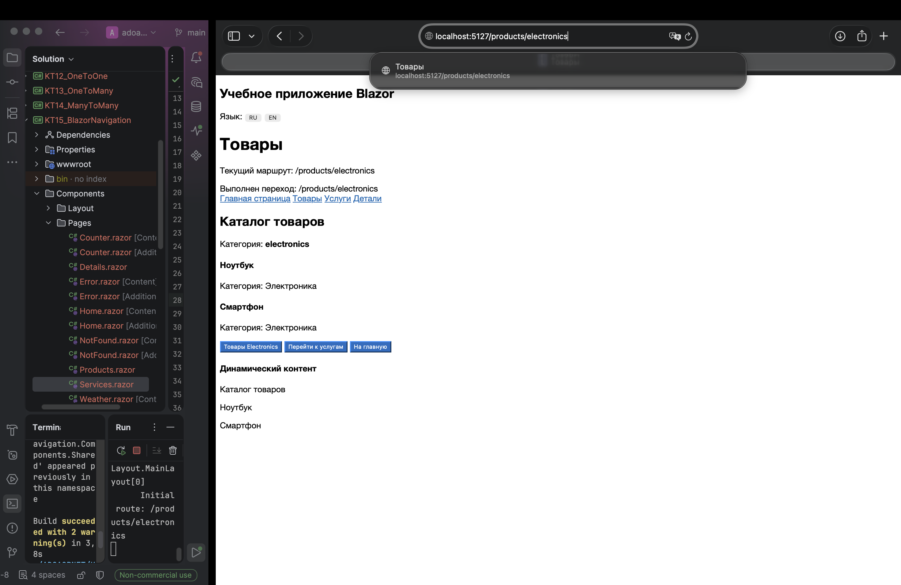
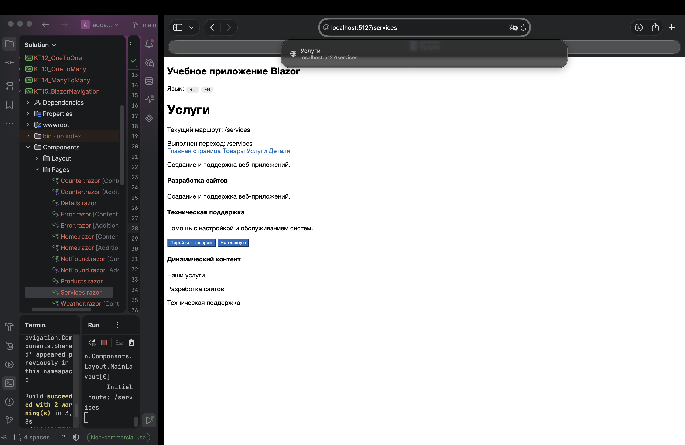
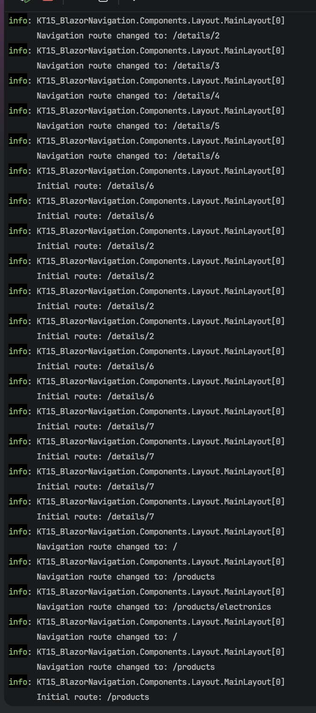

## КТ №15 Вызов и рендеринг главного компоненты

Научиться создавать и рендерить главный компонент, а также понять, как компоненты взаимодействуют между собой и с пользовательским интерфейсом.

Задачи:

Выполнить задание-пример по презентации.
Выполнить задание согласно ТЗ.
Оформить отчет со скриншотами и ссылками на код

Часть 1. Кликер:

Создайте новый компонент StudentComponent.razor, который принимает параметры Name и Age и отображает их.
Добавьте возможность увеличения возраста на 1 при нажатии на кнопку.
Используйте StudentComponent на главной странице и передайте ему параметры.
Создайте кнопку для сброса возраста к начальному значению.

Часть 2. Навигация

Создайте новое Blazor Server приложение и настройте главный компонент App.razor для обработки маршрутов с использованием Router, добавив кастомный компонент для обработки ошибок (например, при вводе некорректного URL).
Реализуйте логирование текущего маршрута с помощью службы NavigationManager и отобразите его в заголовке страницы.
Настройте MainLayout.razor так, чтобы заголовок страницы менялся в зависимости от текущего маршрута, используя параметры и сервисы зависимостей.
Создайте несколько компонентов страниц и настройте их динамическую загрузку в зависимости от параметра маршрута (@page "/details/{id:int}").
Добавьте кнопку на каждой странице, которая будет перенаправлять пользователя на другую страницу с помощью метода NavigationManager.NavigateTo().
Реализуйте глобальный обработчик навигации, который будет отображать уведомление при каждом изменении маршрута.
Настройте параметры маршрута так, чтобы приложение поддерживало необязательные параметры (например, @page "/products/{category?}") и корректно отображало их на странице.
Создайте компонент, который в зависимости от маршрута рендерит разные элементы пользовательского интерфейса (например, отображение товаров или услуг).
Реализуйте функционал локализации, позволяющий переключать язык интерфейса с динамическим обновлением контента без перезагрузки страницы.

