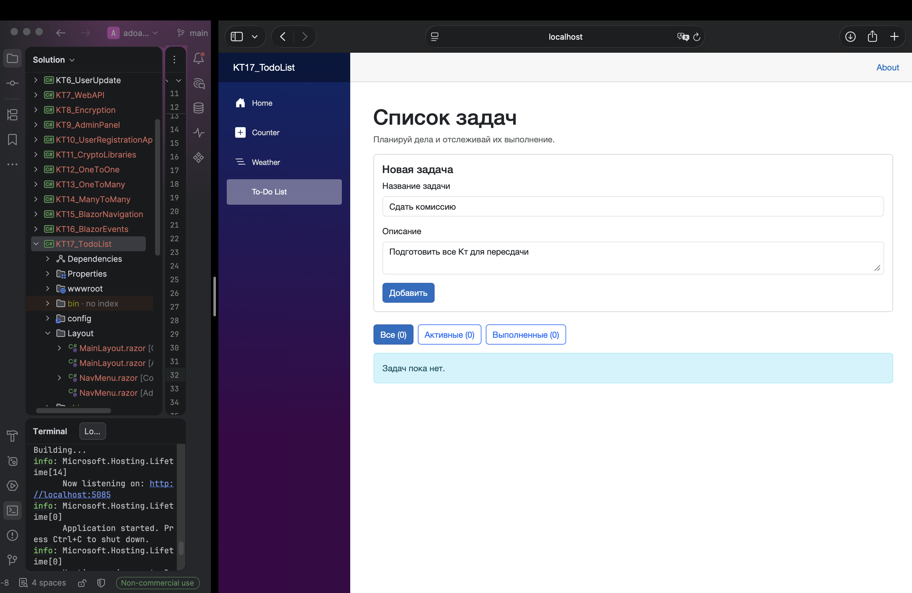
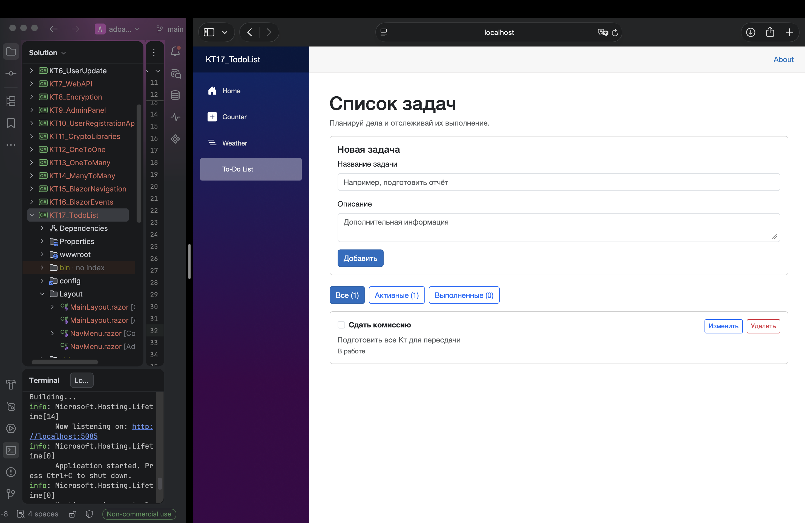
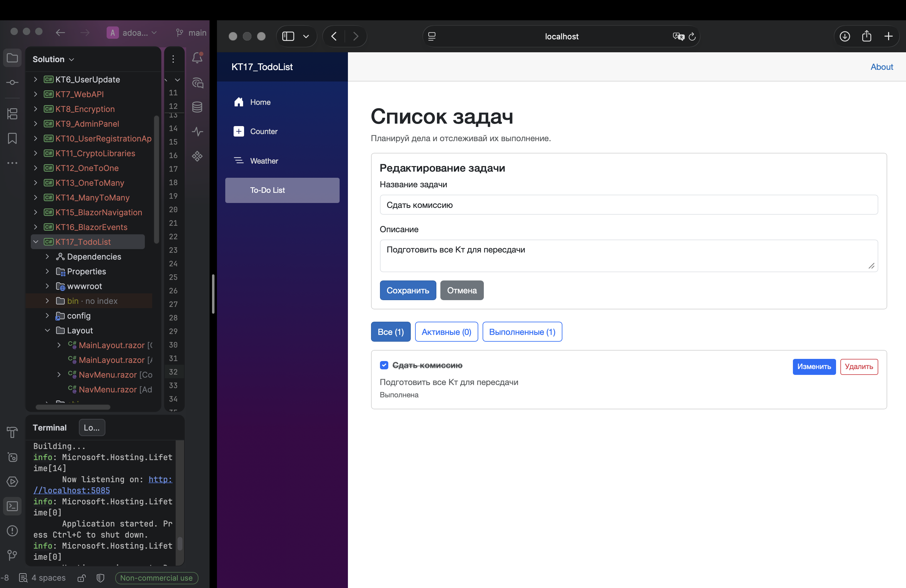

## КТ №17 Выполнение тестовых заданий

### Задачи:
Выполнить задание по ТЗ.
Дополнить функционал задания 1.
Оформить общий отчет со скриншотами и ссылками на код.

### ТЗ:
Добавить страницу с простым списком задач (To-Do List) в проект Blazor WebAssembly.

### Задачи:

Создать страницу To-Do List (полноценный функционал);
Добавить ссылку в навигационное меню;
Запустить и проверить работу.

