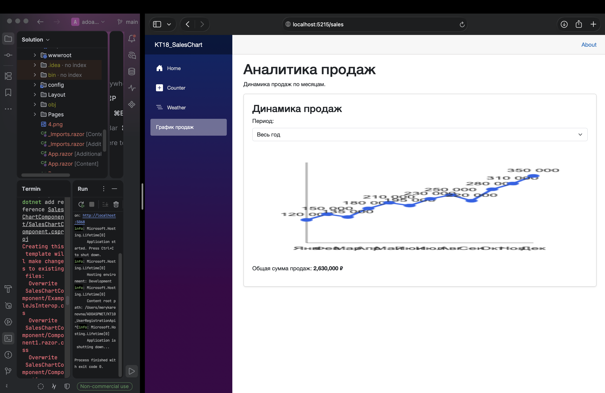
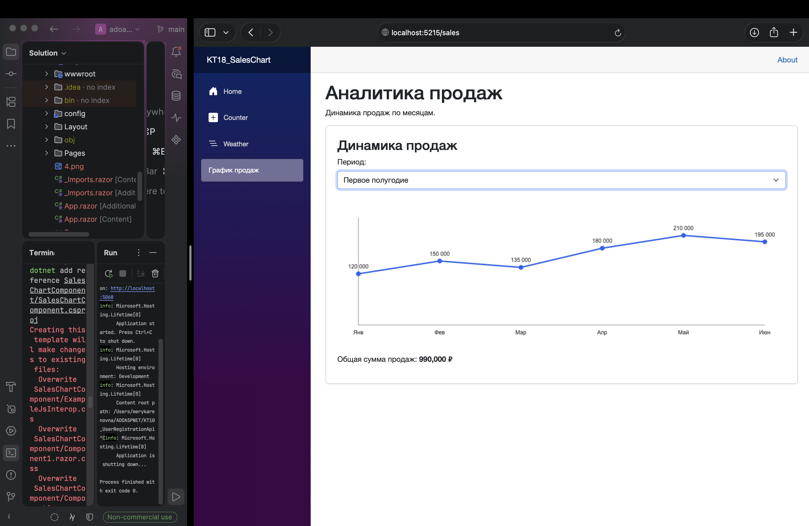
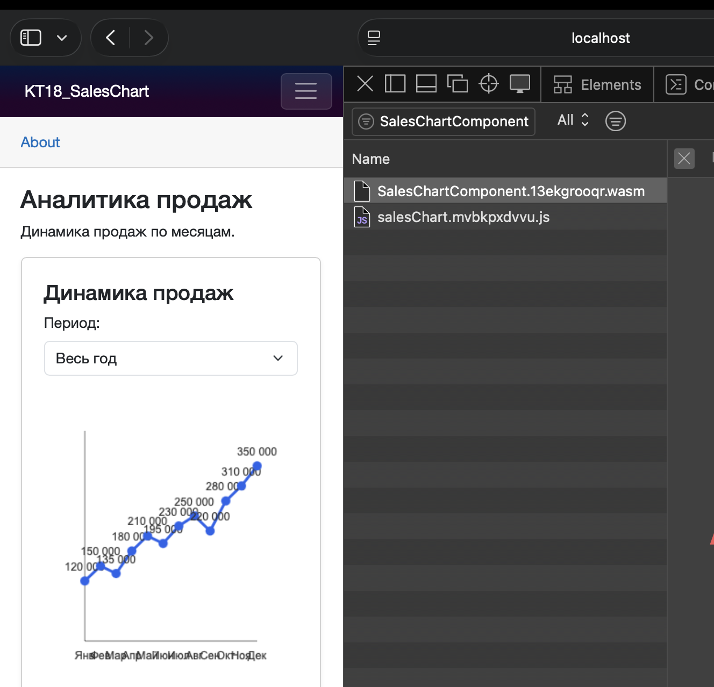

## КТ №18 Выполнение тестовых заданий

### Задачи:
Выполнить задание по ТЗ.
Дополнить функционал задания.
Оформить общий отчет со скриншотами и ссылками на код.

### ТЗ:
Добавить страницу с динамическим графиком продаж, загружаемым из отложенной сборки.

### Задачи:

Создать новую сборку SalesChartComponent.razor;
Добавить функции для отрисовки графиков;
Настройте отложенную загрузку;
Создать страницы с графиком продаж;
Добавить навигацию в NavMenu;
Запустить и проверить работу.

