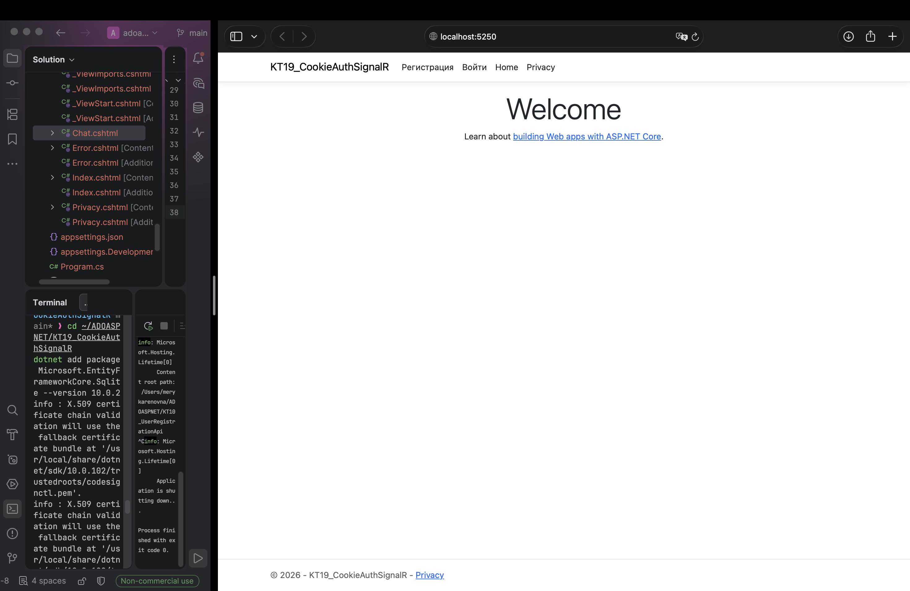
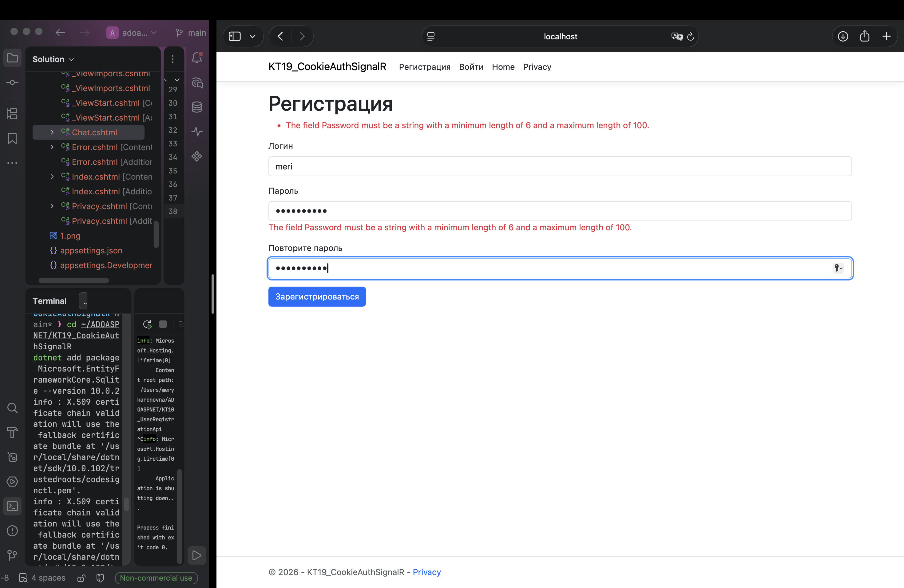
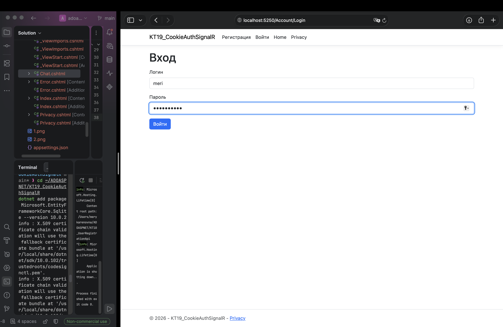
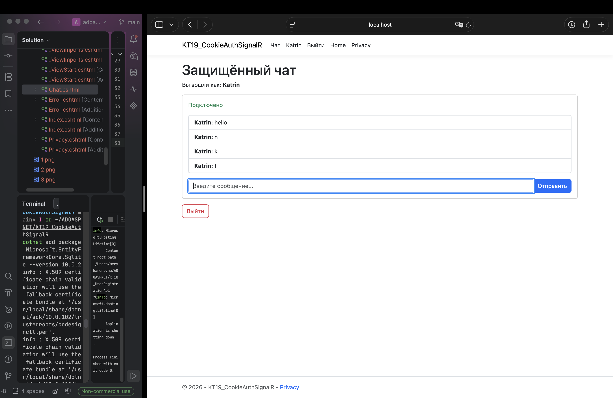

## КТ №19 Аутенфикация и авторизация на основе куки

### Задачи:
Выполнить задание согласно ТЗ (рекомендуется встроить в свой проект);
Составить файл отчета, содержащий скриншоты выполнения и ссылки на код.

### ТЗ:
Настроить аутентификацию и авторизацию на основе куки в приложении ASP.NET Core.
Реализовать регистрацию и вход пользователей.
Создать защищенный чат с использованием SignalR.
Ограничить доступ к чату только авторизованным пользователям.

