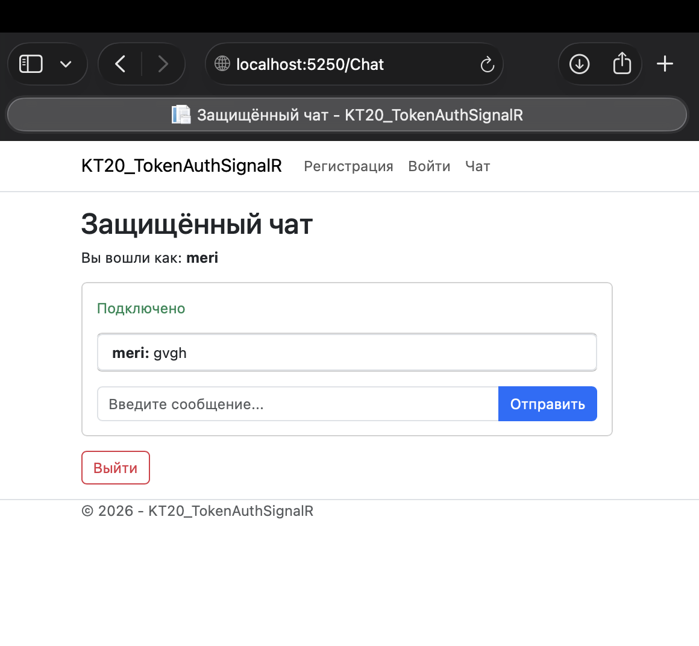
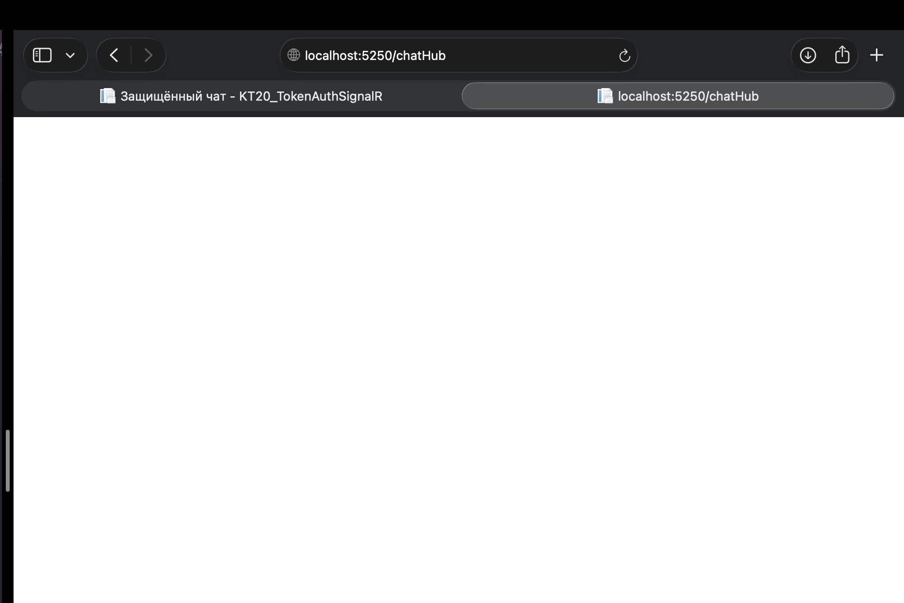
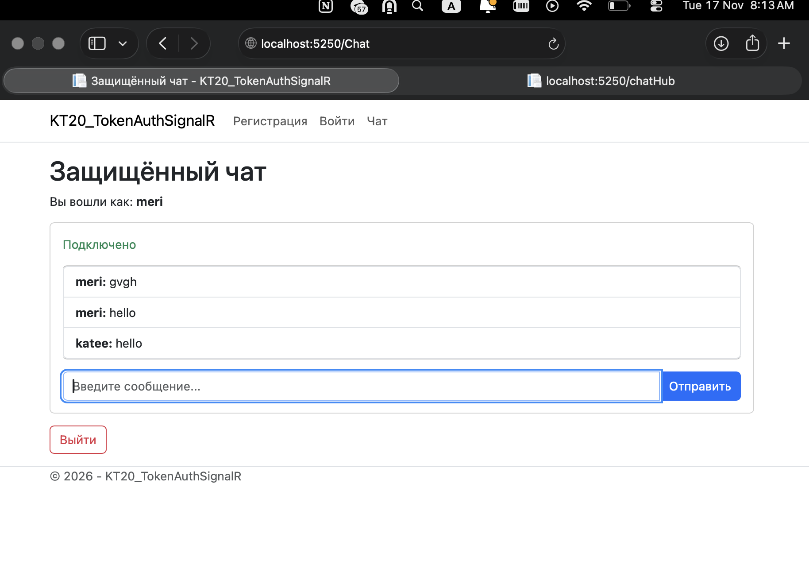
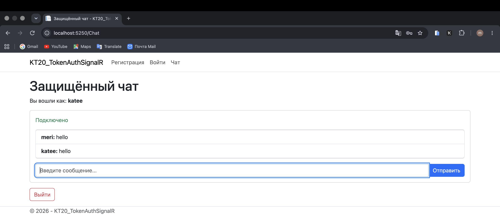

## КТ №20 Аутентификация и авторизация на основе токенов

### Задачи:
Выполнить задание согласно ТЗ;
Составить один файл отчета, содержащий скриншоты выполнения и ссылки на код.

### ТЗ:
Настроить аутентификацию и авторизацию на основе токенов в приложении ASP.NET Core.
Реализовать регистрацию и вход пользователей с генерацией JWT токенов.
Создать защищенный чат с использованием SignalR.
Ограничить доступ к хабу, только авторизованным пользователям с токеном.

