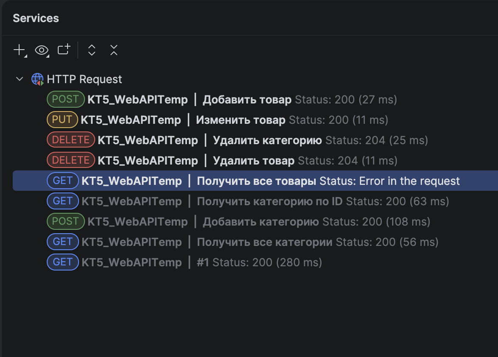

# КТ №5. Реализация API при помощи шаблона

## 1. Задание «Создать шаблон и применить HttpResponse»

**1. Подготовка проекта**
- Создайте новый проект ASP.NET Core API.
- Настройте подключение к базе данных с использованием Entity Framework Core.

**2. Моделирование данных**
- Определите сущности для вашего API. Например, Product, Category.
- Создайте контекст базы данных и определите DbSet для ваших сущностей.

**3. Реализация шаблона Repository**
- Создайте интерфейсы IRepository и IUnitOfWork.
- Реализуйте классы Repository и UnitOfWork, которые будут использоваться для доступа к данным.

**4. Разработка контроллеров**
- Создайте API контроллеры, которые будут обрабатывать запросы к вашим сущностям.
- Реализуйте CRUD операции для каждой из сущностей.

**5. Работа с данными**
- Используйте миграции для создания и обновления схемы базы данных.
- Заполните базу данных начальными данными.

**6. Тестирование API**
- Протестируйте ваше API с использованием Postman или аналогичного инструмента.

Все перечисленные запросы завершились успешно, кроме получения списка всех товаров(

