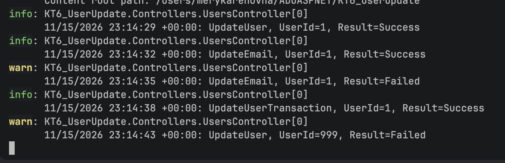

# КТ6. Обновление данных пользователя при помощи запросов

### Задание 1. Обновление нескольких полей
Добавить поле `Age` в таблицу `Users` и расширить API-метод обновления пользователя, чтобы он мог изменять возраст вместе с именем и электронной почтой.

### Задание 2. Условное обновление
Реализовать API-метод, который обновляет электронную почту пользователя только в том случае, если его текущее имя совпадает с переданным именем. Для этого добавить дополнительное условие в SQL-запрос `WHERE`.

### Задание 3. Транзакции
Изменить один из методов обновления, добавив SQL-транзакцию. Все операции должны выполняться успешно целиком либо отменяться при возникновении ошибки.

### Задание 4. Обработка исключений
Добавить обработку ошибок, связанных с подключением к базе данных и выполнением SQL-запросов. Возвращать подходящие API-ответы.

### Задание 5. Логирование
Реализовать логирование каждого запроса на обновление, включая время выполнения и результат — успешное выполнение или ошибку.

## Проверка

Реализованы:
- обновление имени, email и возраста;
- условное обновление email;
- транзакционное обновление данных;
- обработка исключений;
- логирование запросов.
