# Задание «КТ-7»

## Задание 1. Список студентов
Разработать веб-API, которое позволяет управлять списком студентов: 

- просматривать список студентов
- добавлять нового студента 
- обновлять данные студента и удалять студента из списка

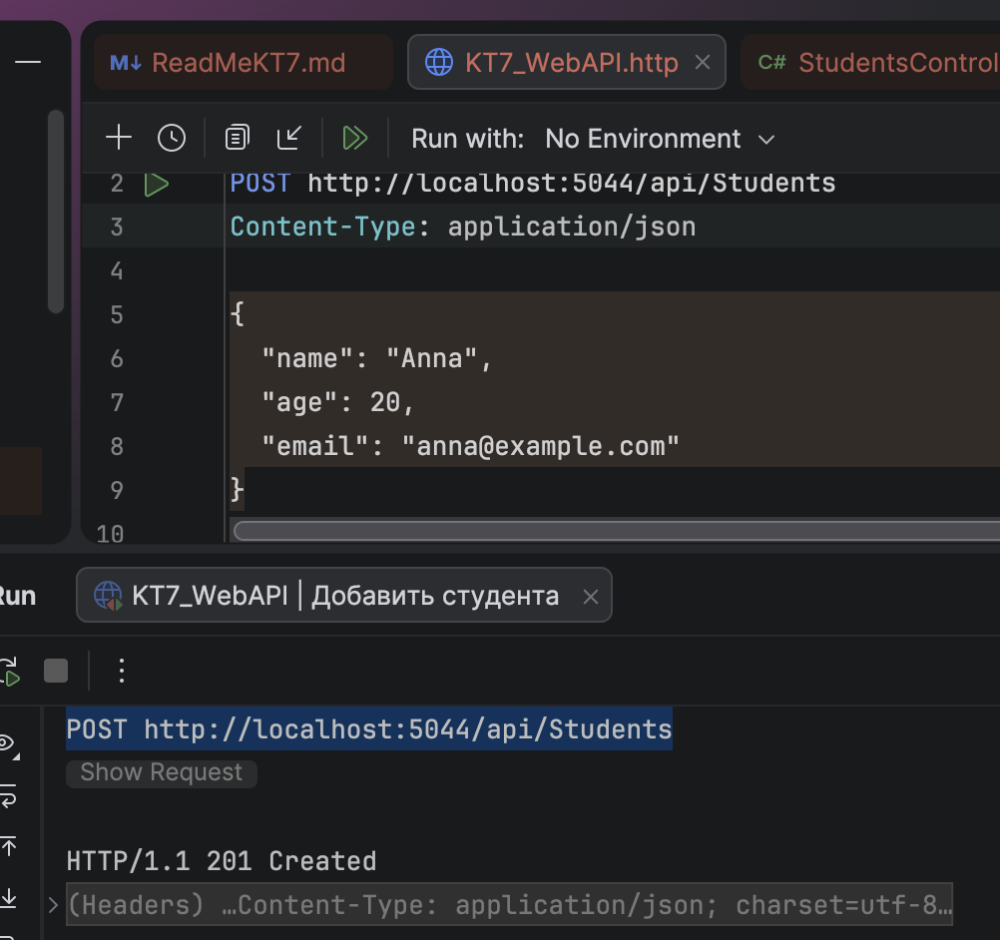
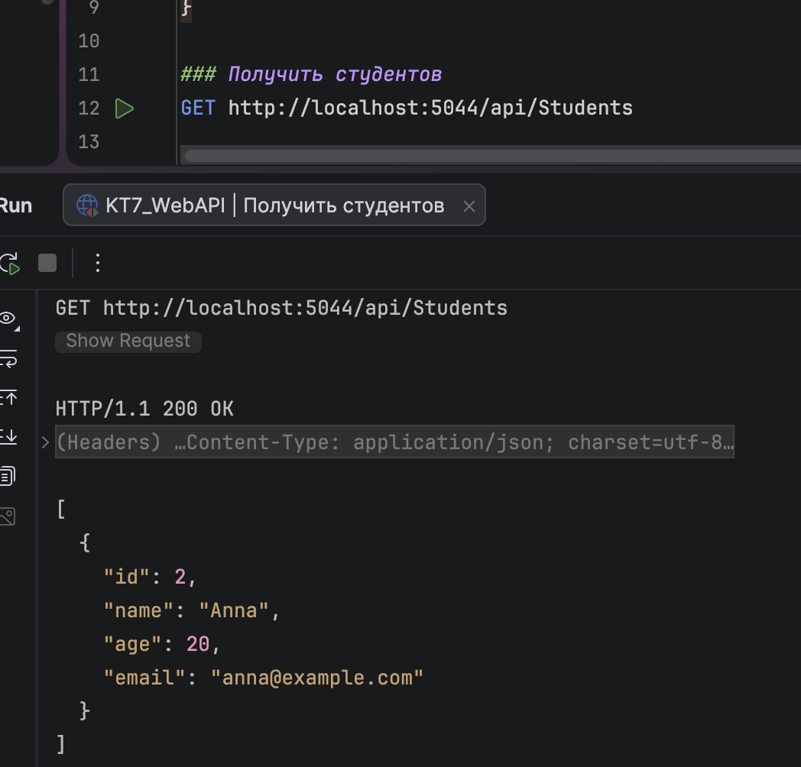
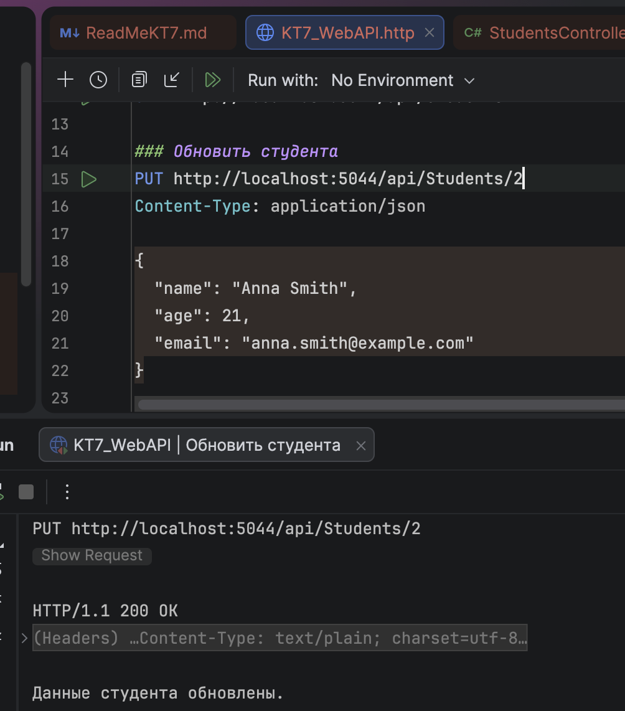
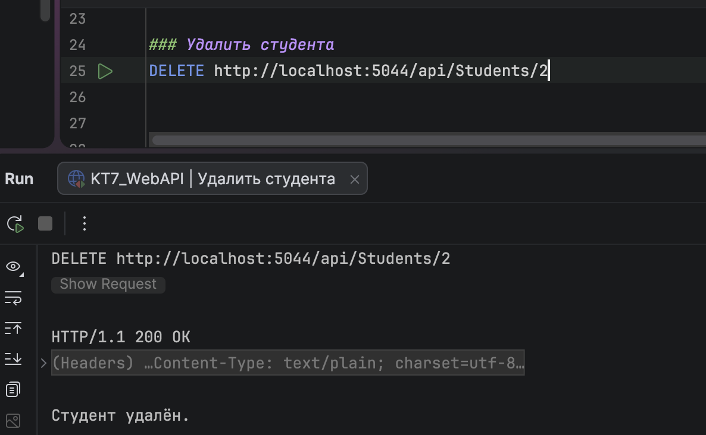

## Задание 2. TMS
Разработайте веб-API для системы управления задачами (Task Management System), позволяющую выполнять следующие операции:
- Создание задачи с указанием названия и описания.
- Получение списка всех задач.
- Обновление статуса задачи (например, новая, в работе, выполнена).
- Удаление задачи.

Ваше API должно поддерживать фильтрацию задач по статусу при выполнении запроса на получение списка.

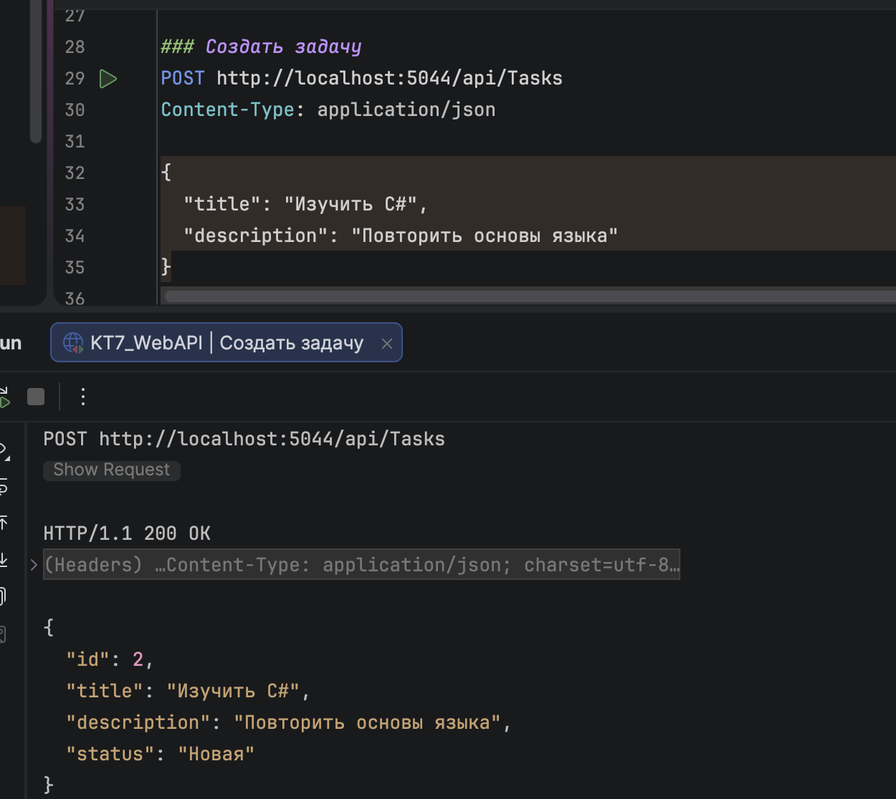
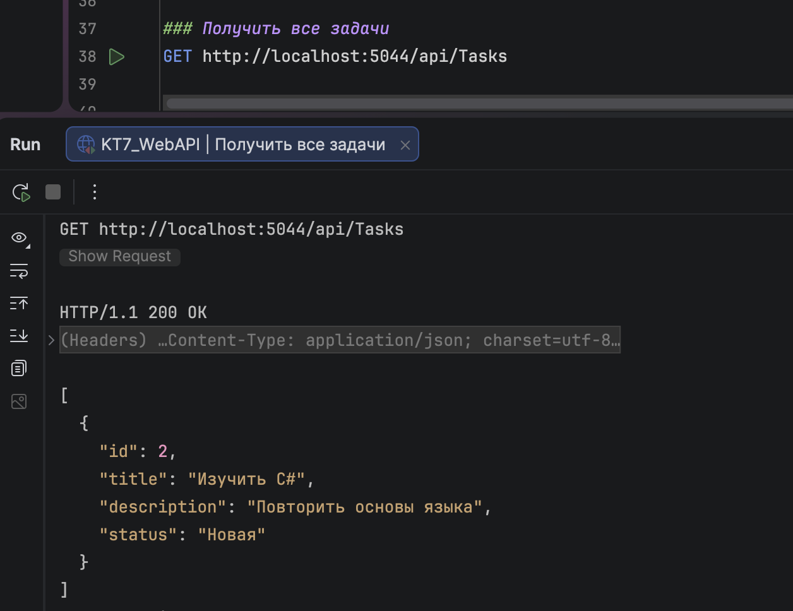
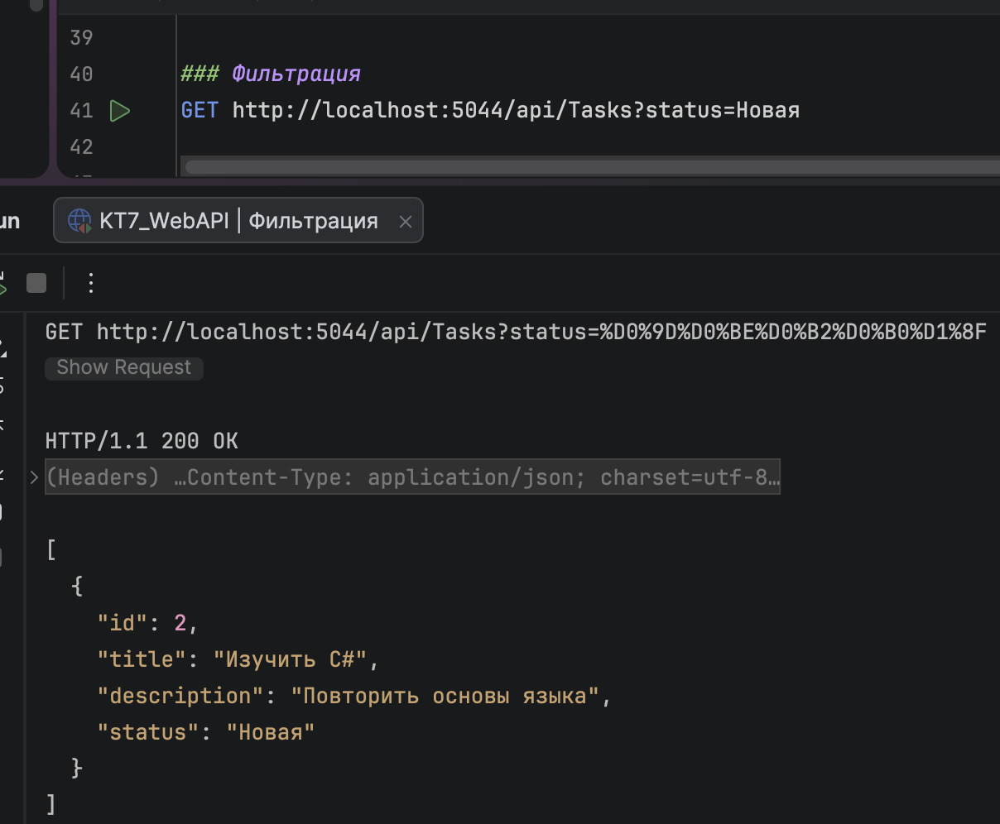
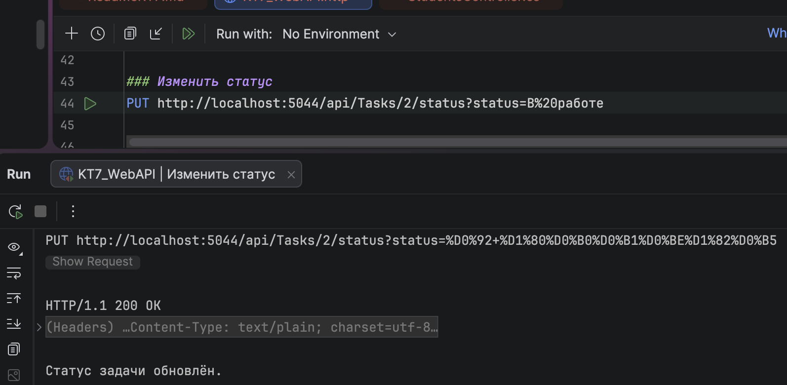
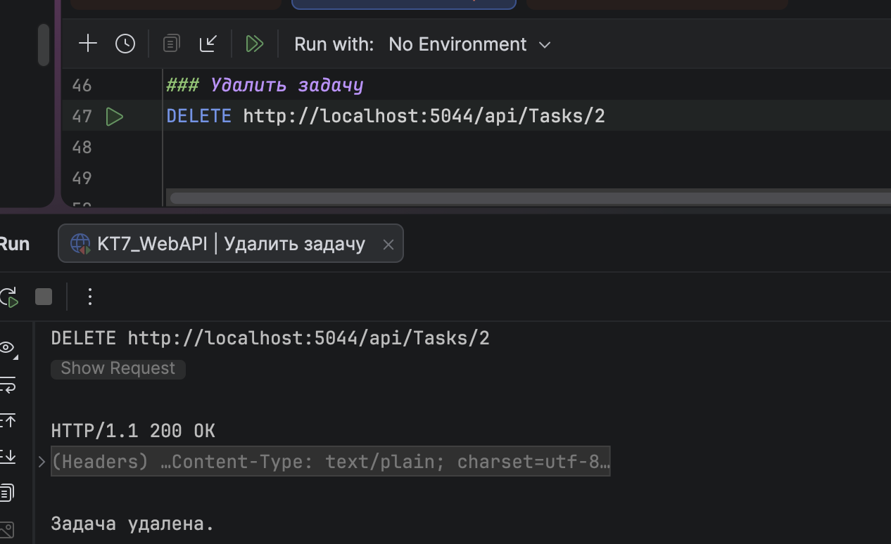

## Задание 3. Бронирование
Создайте веб-API для системы бронирования (например, отелей, авиабилетов, столов в ресторане), которое включает в себя следующие функции:
- Бронирование ресурса с указанием даты и времени.
- Просмотр доступных ресурсов для бронирования в заданный период времени.
- Отмена бронирования.
- Обновление деталей бронирования (например, изменение даты или времени).
API должно предусматривать возможность работы с различными типами ресурсов для бронирования, используя обобщенный подход.

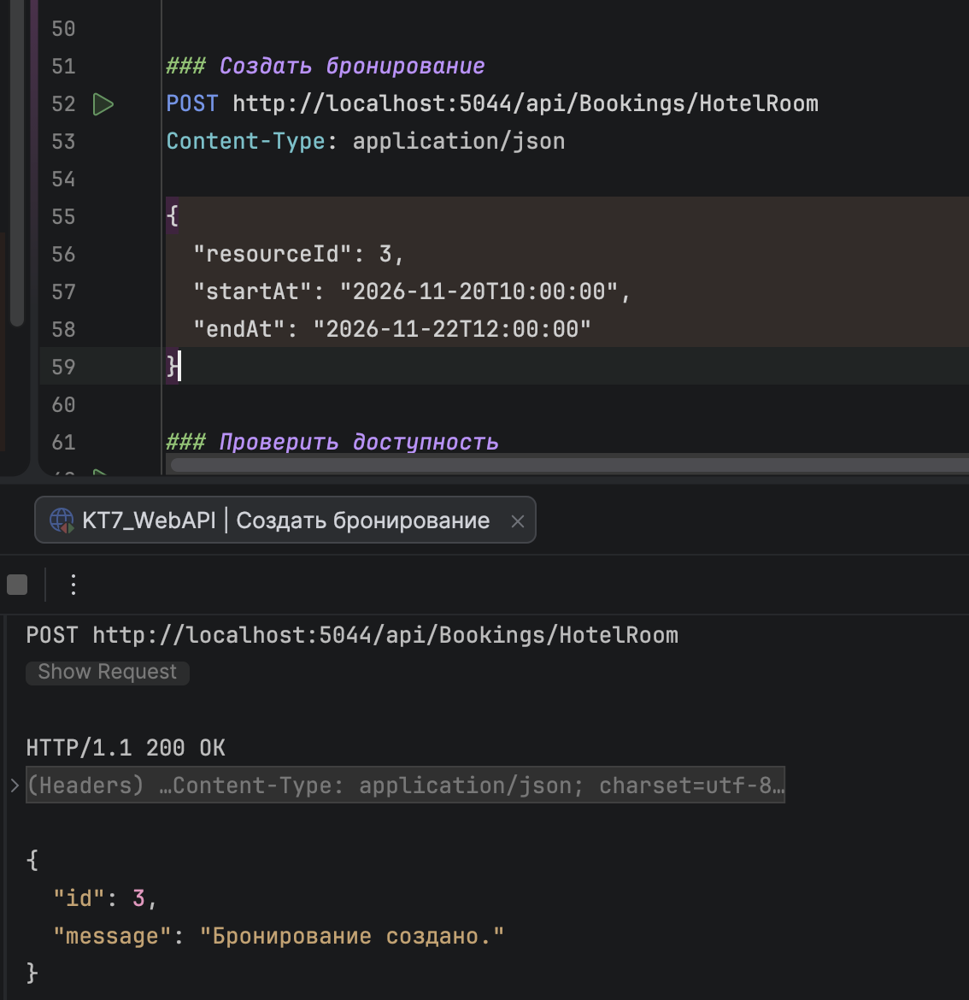

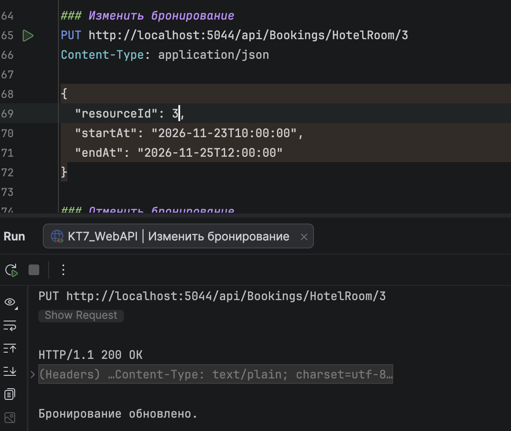
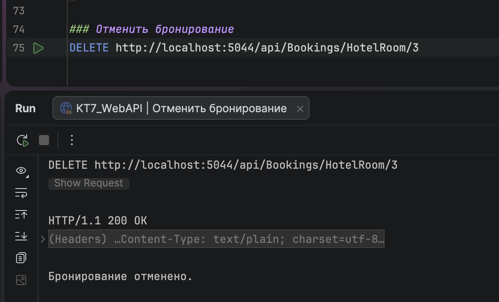
