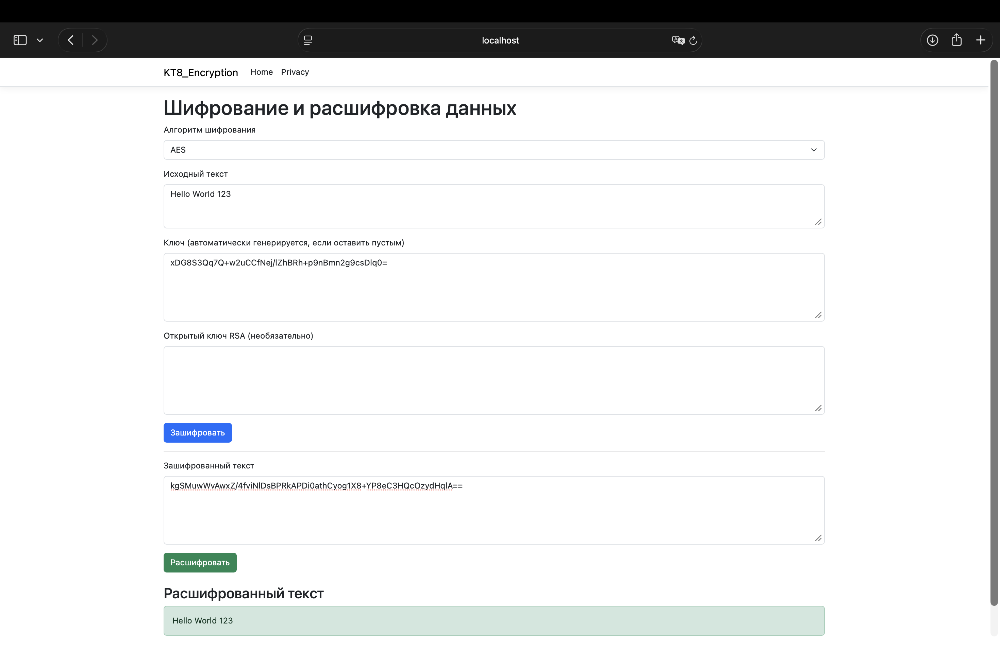
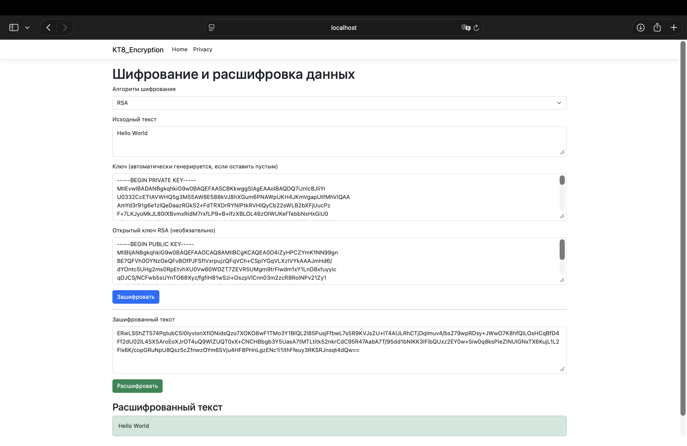

# Задание «КТ-8»

Создайте новый проект ASP.Net Core с веб-интерфейсом.
Добавьте необходимые зависимости для работы с шифрованием.
Разработайте простой веб-интерфейс с формой для ввода текста, который будет шифроваться.
Добавьте возможность выбора алгоритма шифрования (например, AES или RSA).
Предоставьте поля для ввода ключа шифрования (или сгенерируйте его автоматически).
Обеспечьте шифрование введенных данных и их последующий вывод на странице.
Реализуйте функцию дешифрования для проверки корректности шифрования.

