## КТ №9 Админ-панель
Создайте проект ASP.Net Core (MVC или Razor Pages). 
Настройте Identity Framework для аутентификации пользователей.
Создайте роли администратора и обычного пользователя.
Настройте политики авторизации для доступа к админ-панели.
Создайте основной шаблон админ-панели с навигацией по разделам: пользователи, настройки, отчеты.
Реализуйте функциональность для просмотра, добавления, редактирования и удаления пользователей.
Разработайте формы для добавления и редактирования пользователей.

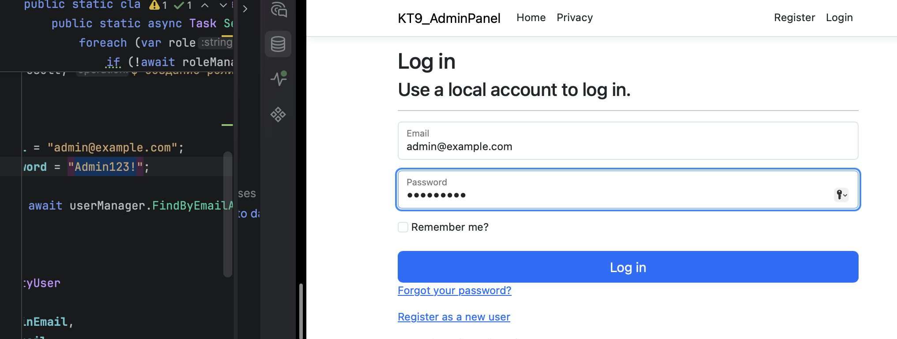

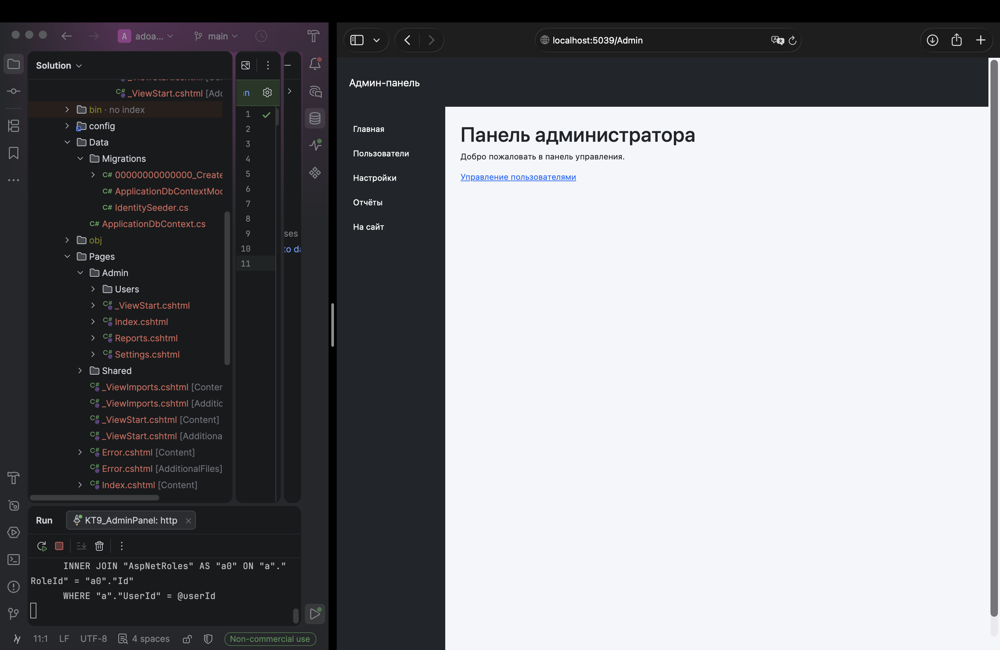
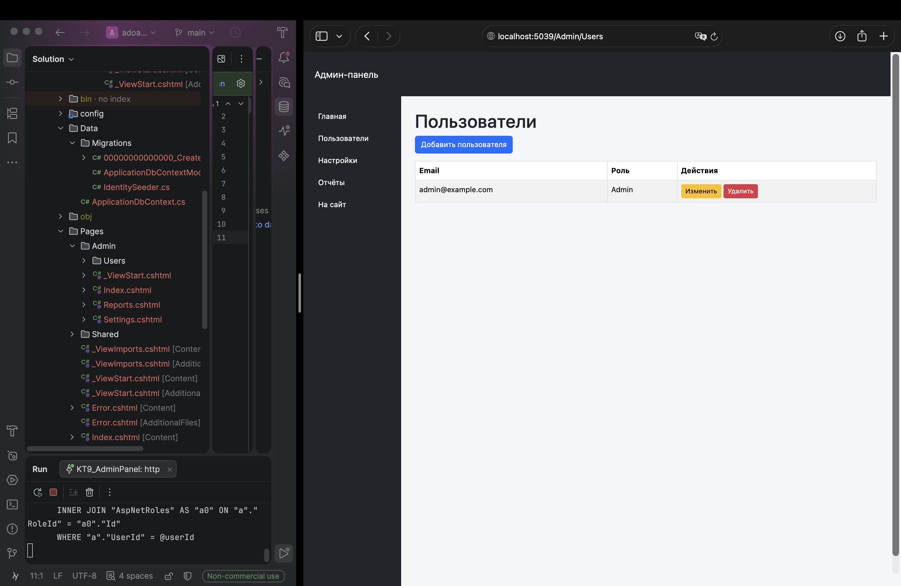
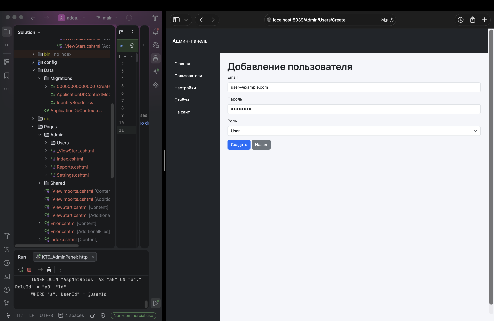
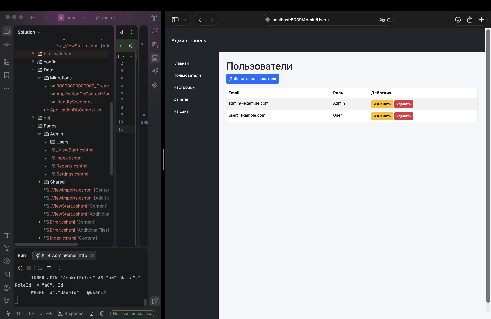
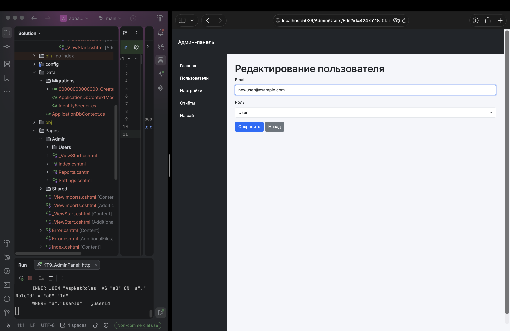
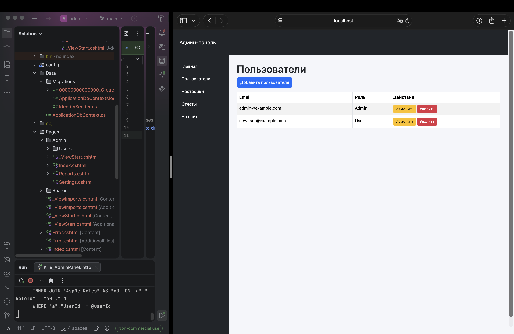
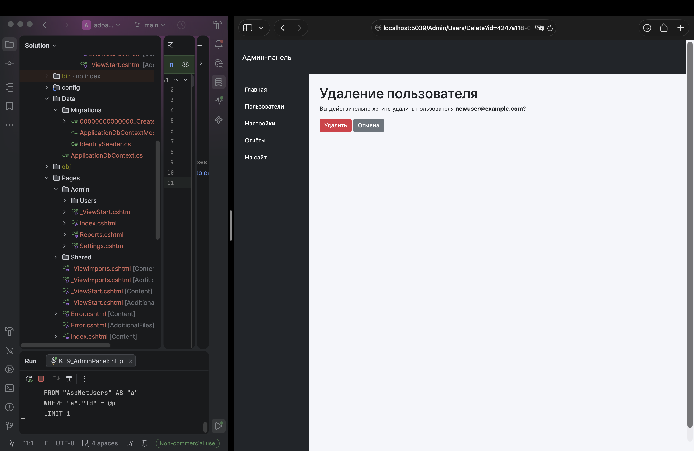
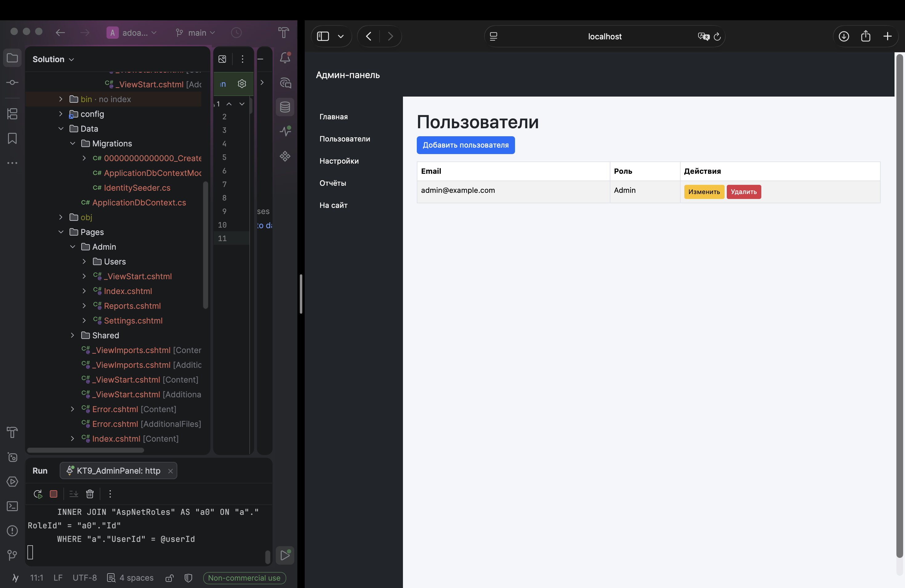

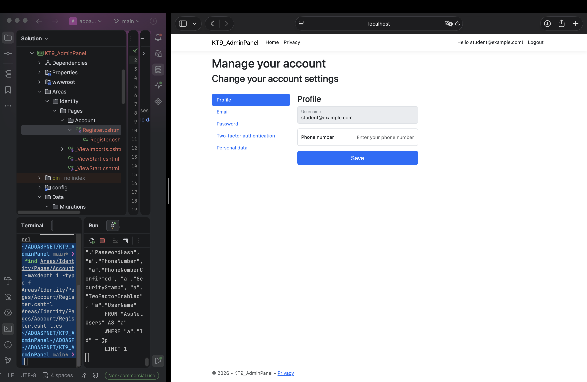
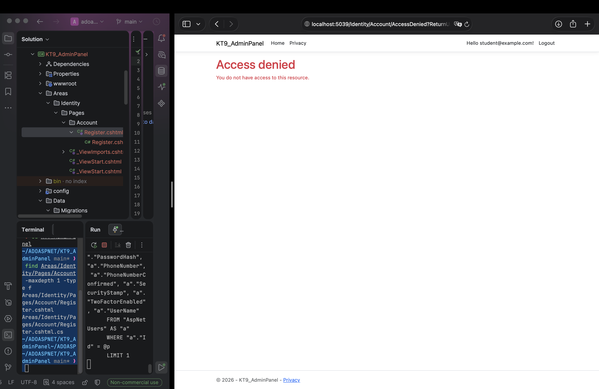

